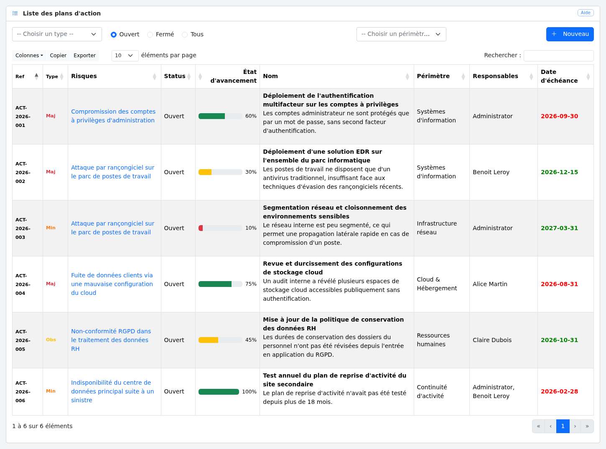
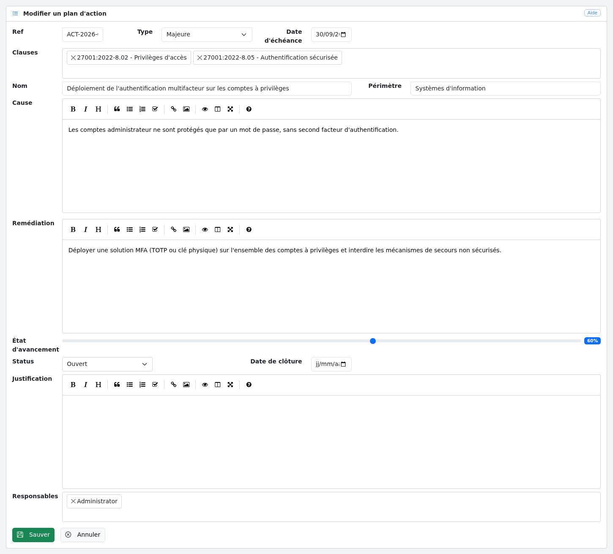

# Plans d'action

Chaque fois qu’un contrôle est en échec (orange ou rouge), un plan d’action doit être mis en place et suivi afin de remédier à la situation.

## Liste des plans d’action 

Cet écran permet de suivre les plans d’action :

La liste peut être filtrée par type (majeur, mineur, observation, opportunité), par statut (ouvert, fermé, tous) et par périmètre.
Elle affiche pour chaque plan d’action sa référence, son type, son statut, son avancement, son nom, son périmètre,
ses responsables et sa date d’échéance. Les dates d’échéance dépassées sont affichées en rouge.

Le bouton « Colonnes » permet d’afficher des colonnes supplémentaires (clauses associées, remédiation),
et les boutons « Copier », « CSV », « Excel » et « Imprimer » permettent d’exporter la liste affichée.

En cliquant sur la référence d’un plan d’action, vous arrivez sur ce plan d’action. Le bouton « Nouveau » permet de créer un nouveau plan d’action.

## Modifier un plan d’action 

Cet écran permet de modifier un plan d’action et de planifier la prochaine évaluation du contrôle.

Lorsque vous cliquez sur :

* « Sauver », vous sauver le plan d’action et revenez à la [liste des plans d’action](#list)

* « Annuler » vous revenez à la [liste des plans d’action](#list)
