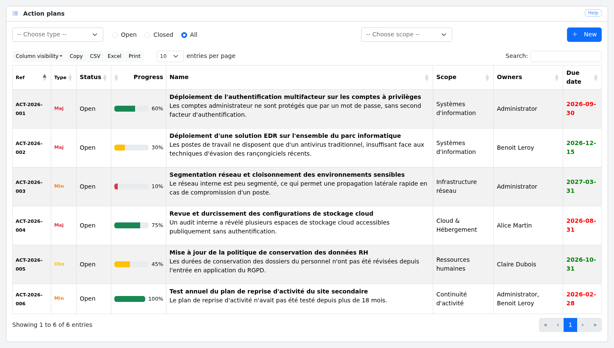
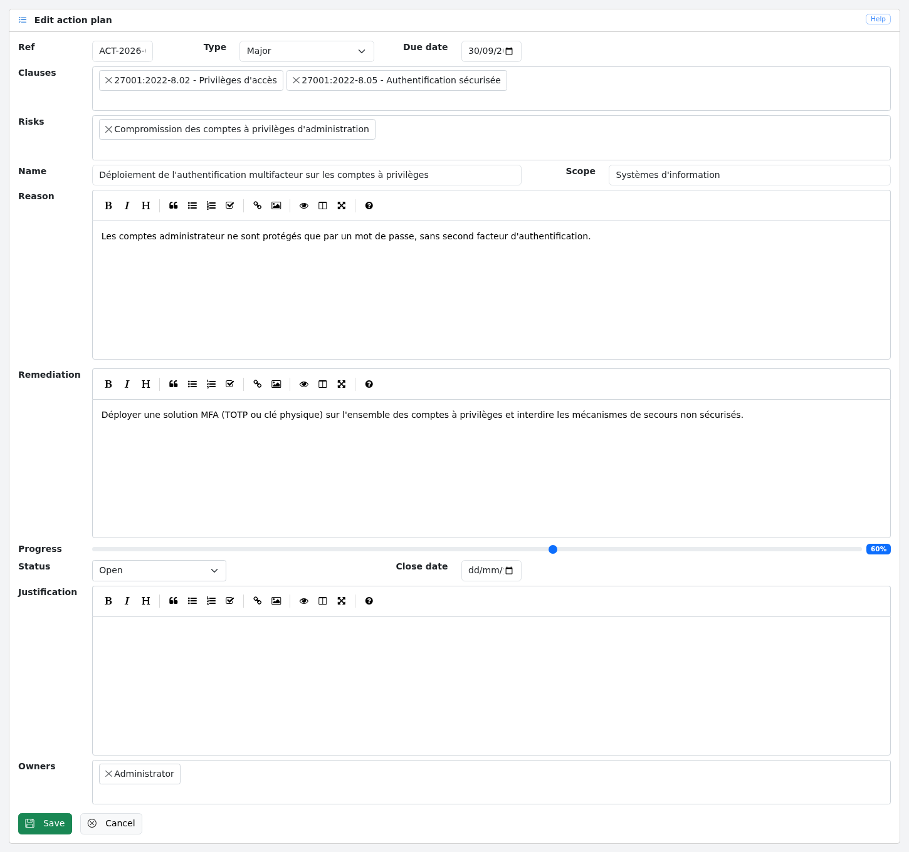

# Action Plans

Each time a control fails (orange or red), an action plan must be put in place and followed in order to remedy the situation.

## List of Action Plans 

This screen allows you to follow the action plans:

The list can be filtered by type (major, minor, observation, opportunity), by status (open, closed, all) and by scope.
It shows, for each action plan, its reference, type, status, progress, name, scope, owners and due date.
Overdue due dates are displayed in red.

The "Column visibility" button lets you show additional columns (associated clauses, remediation),
and the "Copy", "CSV", "Excel" and "Print" buttons export the displayed list.

Clicking on the reference of an action plan opens it. The "New" button creates a new action plan.

## Edit an action plan 

This screen allows you to edit an action plan and schedule the next control assessment.

When you click:

* "Save", you save the action plan and return to the [list of action plans](#list)

* "Cancel" you return to the [list of action plans](#list)
