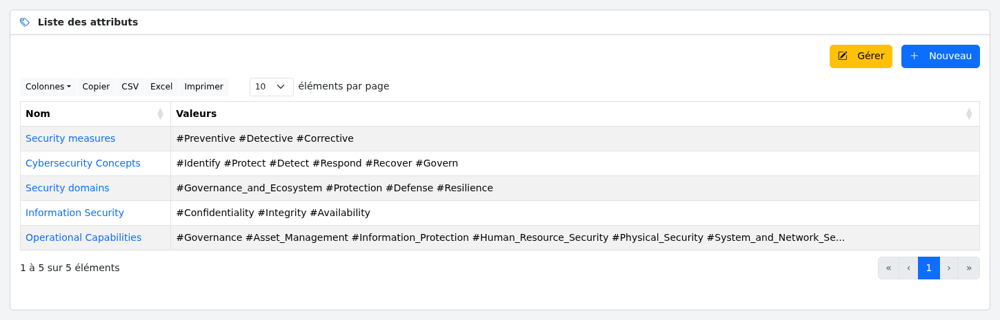
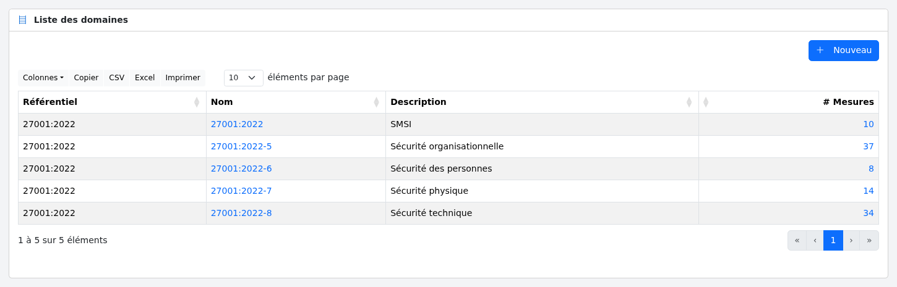
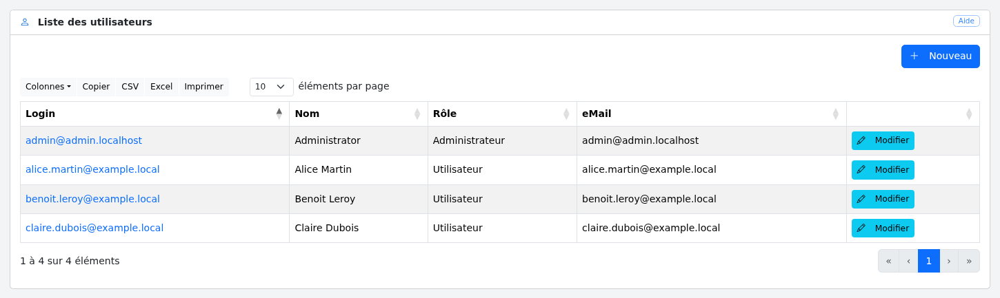
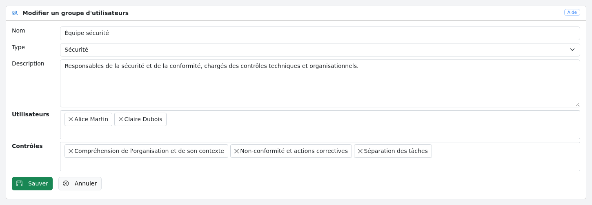
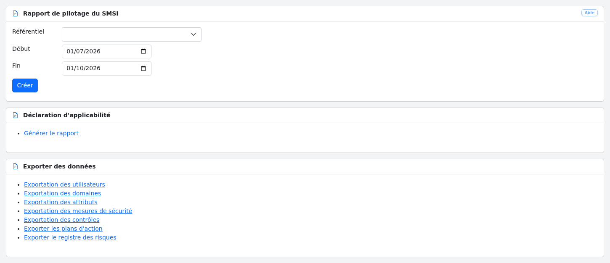
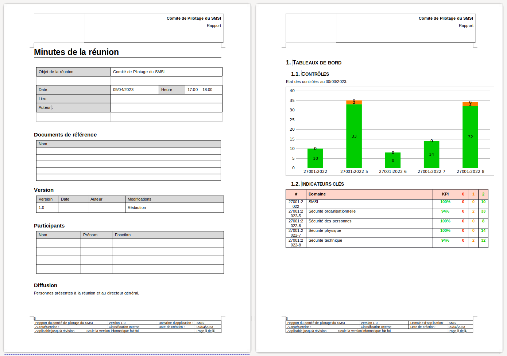
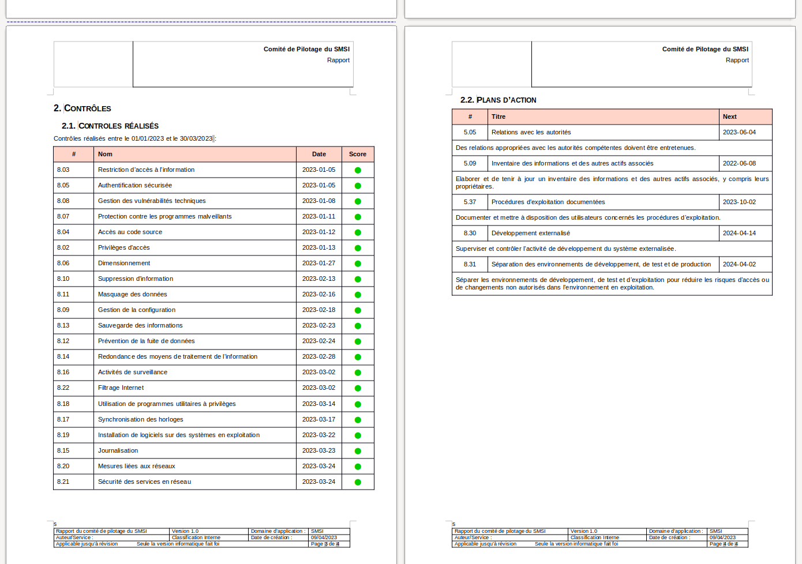
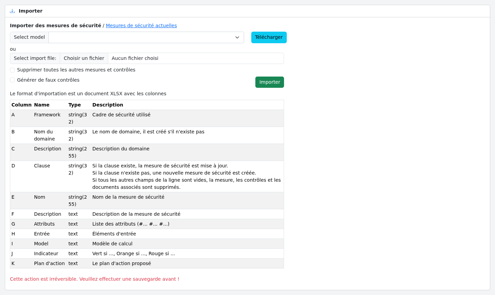
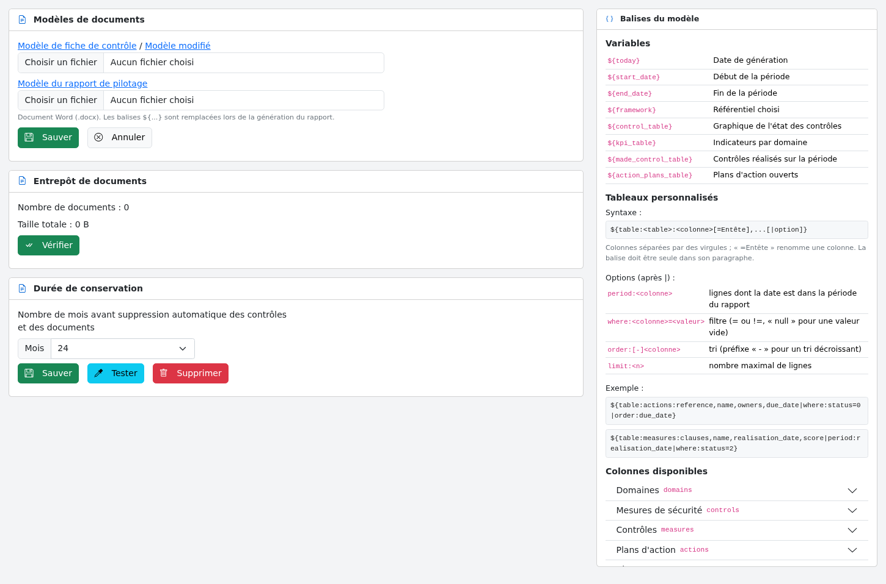
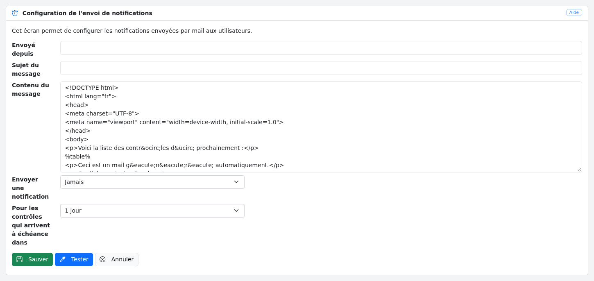

# Configuration

## Attributs {#tags}

Cet écran permet de gérer les attributs associés aux mesures de sécurité.
Il contient la liste des attributs et permet de créer, supprimer ou modifier des listes d’attributs.

Les administrateurs disposent d'un bouton « Gérer » qui ouvre un formulaire permettant de remplacer globalement une valeur d'attribut existante par une nouvelle valeur. Le remplacement s'applique partout où la valeur est utilisée : dans les listes d'attributs, dans les contrôles, ainsi que dans les controles qui n'ont pas encore été réalisés. Les contrôles déjà réalisés ne sont pas modifiées, car ils constituent un historique.

## Domaines {#domains}

Cet écran permet de créer, modifier ou supprimer des listes de domaines de sécurité.

L’application est fournie avec une base de mesures de sécurité inspirée de la norme ISO 27001:2022, mais il est possible de définir de nouveaux domaines de sécurité inspirés d’autres normes comme PCI DSS, HDS...

## Utilisateurs {#users}

Les utilisateurs sont définis dans l’application.

Il existe quatre rôles différents :

* Administrateurs : L'administrateur de l’application peut créer de nouveaux utilisateur, des mesures, de nouveaux attributs, modifier des contrôles déjà réalisés.

* Utilisateurs : les utilisateurs peuvent utiliser l’application sans pouvoir modifier les mesures, les attributs et les contrôles déjà réalisés.

* Audité : les audités ne peuvent réaliser et voir que les contrôles qui leur sont assignés ou qu'ils ont réalisés précédemment.

* Auditeur : l’auditeur a un accès en lecture à l’ensemble des informations de l’application.

## Groupes {#groups}

Cet écran permet de définir des groupes d'utilisateurs.
Un groupe permet de rassembler un ensemble d'utilisateurs et de contrôles.

Un groupe est composé :

* d'un nom de groupe
* d'un type : *Business* ou *Sécurité* (modifiable uniquement par un administrateur)
* d'une description du groupe
* d'une liste d'utilisateurs
* d'une liste de contrôles

Le type du groupe permet de distinguer les contrôles portés par l'équipe Sécurité de ceux portés par les autres
fonctions métier dans l'écran de [pilotage](dashboards.md#steering).

Seuls les contrôles non encore réalisés sont proposés dans le formulaire ; les contrôles réalisés ou proposés
restent liés au groupe lors de sa modification.

## Rapports {#reports}

L’application permet de générer le rapport de pilotage du SMSI et d’exporter dans un fichier Excel la liste des domaines, les mesures de sécurités et tous les contrôles réalisés.

Voici le rapport de pilotage du SMSI :

[{: style="width:600px"}](images/report1.png)

[{: style="width:600px"}](images/report2.png)

## Importation {#import}

Il est possible d'importer des mesures de sécurité depuis un fichier .XLSX ou depuis la base de données de modèles.

Lors de l'importation, il est possible de supprimer tous les autres contrôles et mesures et de générer des données de test.

## Documents {#documents}

Cet écran permet de modifier la configuration de la gestion des document utilisés dans Deming.

### Modèles

Cette partie de l'écran permet de modifier les modèles de document utilisés pour les fiches de contrôle et le rapport de pilotage du SMSI et permet d’avoir une vue sur l’ensemble des documents utilisés comme preuve lors de la réalisation des contrôles de sécurité.

### Stockage

Cette partie de l'écran permet de vérifier l'intégrité des documents conservés dans l'application.

En cliquant sur « Vérifier », Deming lance le contrôle d'’intégrité des documents conservés dans l'application en utilisant un CRC32.

### Conservation

Cette partie de l'écran permet de configurer la durée de conservation (en mois) des contrôles réalisés dans l'application.

Touts les contrôles réalisés passé cette date sont supprimés ainsi que les documents et plans d'actions associés.

Cette suppression est effectuée en exécutant la commande

    php artisan deming:cleanup

au travers d'un cron.

## Notifications 

Cet écran permet de configurer les notifications envoyées aux utilisateurs lorsqu'ils doivent réaliser des contrôles.

L'écran contient :

* Le sujet du mail envoyé à l'utilisateur;

* L'émetteur du mail;

* La périodicité de l'envoi des notifications;

* Le délais de notification.

Lorsque vous cliquer sur :

* "Sauver" - la configuration est sauvée;

* "Test" - un mail de test est envoyé à l'utilisateur courant ;

* "Cancel" - vous revenez à la page principale.
