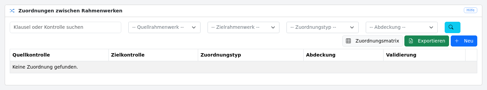

# Zuordnungen zwischen Rahmenwerken

Das Modul `/crosswalk` verwaltet generische dokumentarische Beziehungen zwischen zwei Sicherheitsmaßnahmen. Es enthält keine Regel, die spezifisch für ISO, NIS2 oder ein anderes Rahmenwerk ist.

## Datenmodell

Die Tabelle `frameworks` ergänzt die bereits in `Domain.framework` vorhandenen Codes um Metadaten. Sie ersetzt dieses Feld nicht und ändert seine Bedeutung nicht. Die erste Migration legt für jeden vorhandenen Code eine Metadatenzeile an. Anschließend legt auch das Speichern einer Domäne die minimalen Metadaten ihres Codes an.

Eine Zeile `control_mappings` wird einmalig von `source_control_id` nach `target_control_id` gespeichert. Die Anwendung liest diese Beziehung auch in umgekehrter Richtung. In diesem Fall wird `covers` zu `covered_by` und umgekehrt. Die Umkehrung von `supports` wird als `supported_by` („profitiert von der Unterstützung durch“) angezeigt, ohne diesen Wert zu den gespeicherten Typen hinzuzufügen. Es wird keine Spiegelzeile erstellt.

Die zulässigen Typen sind `equivalent`, `covers`, `covered_by`, `partial`, `supports` und `related`. Die zulässigen Abdeckungswerte sind `full`, `high`, `medium`, `low` und `none`.

## Berechtigungen und Ansichten

Alle angemeldeten Benutzer können die Liste, die Details, die Matrix und die Exporte einsehen. Nur Administratoren (`role=1`) können eine Beziehung erstellen, ändern, validieren oder löschen.

Die Matrix zeigt dokumentarische Kennzahlen: Anzahl der Quellmaßnahmen, Anzahl der Maßnahmen mit Beziehung, Anzahl der Maßnahmen ohne Beziehung und Anzahl der Beziehungen. Diese Werte sind niemals Konformitätsbewertungen.

Die Liste der Zuordnungen ist über das Menü „Konfiguration > Zuordnungen“ erreichbar:

[](images/crosswalk.de.png)

## XLSX-Import

Befehl:

```console
php artisan deming:import-mappings datei.xlsx
```

Optionen:

- `--dry-run` validiert die gesamte Datei, ohne zu schreiben;
- `--update` erlaubt die Aktualisierung eines bestehenden Quell-/Zielpaares.

Erforderliche Spalten:

```text
source_framework, source_clause, target_framework, target_clause,
mapping_type, coverage, rationale, source_reference, source_url
```

Die Spalte `confidence` ist optional (eine Zahl von 0 bis 100). Sie wird in die Exporte übernommen, damit Hin- und Rückwege verlustfrei möglich sind. Fehlt die Spalte bei `--update`, bleibt der bestehende Wert erhalten; ist sie mit einer leeren Zelle vorhanden, wird der Wert gelöscht. Wird eine Beziehung `supports` aus einer umgekehrten Ansicht exportiert, bleiben ihre gespeicherte Quelle, ihr Ziel und ihr Typ erhalten: Der Export einer gerichteten Zeile darf „A unterstützt B“ niemals in „B unterstützt A“ verwandeln.

Alle Zeilen werden vor dem ersten Schreibvorgang validiert. Die Schreibvorgänge erfolgen anschließend in einer einzigen Transaktion. Ein Fehler verhindert daher jeden teilweisen Import. Eine durch den Import geänderte Beziehung muss erneut validiert werden.

## Erster Datensatz ReCyF 2.5 nach ISO 2700X

`storage/app/crosswalks/ReCyF-2.5-ISO27001-2022.mappings.xlsx` enthält 281 Beziehungen aus dem offiziellen Vergleichswerkzeug der ANSSI. Sie decken 118 ReCyF-Maßnahmen und 66 ISO-Maßnahmen ab, die in `ISO27001-2022.fr.xlsx` vorhanden sind.

Diese Arbeitsmappe enthält nur die Beziehungen: Sie erstellt die Maßnahmen nicht. Vor dem Import muss die Instanz daher bereits die Quellmaßnahmen unter dem exakten Code `Domain.framework = NIS2-ReCyF-2.5-FR` und die Zielmaßnahmen unter `Domain.framework = 27001:2022` enthalten. Dies ist insbesondere bei der für diesen Datensatz beschriebenen ReCyF-Instanz mit 152 Maßnahmen der Fall. Führen Sie vor dem eigentlichen Import immer `--dry-run` auf der Zielinstanz aus; eine fehlende oder mehrdeutige Klausel blockiert die gesamte Datei.

Der Datensatz ist bewusst zurückhaltend:

- es werden nur Referenzen übernommen, die von der ANSSI veröffentlicht wurden und genau in der ISO-Arbeitsmappe von Deming vorkommen;
- jede Beziehung ist vom Typ `related`, da eine dokumentarische Zuordnung weder eine Gleichwertigkeit begründen noch eine Konformität implizieren kann;
- die ANSSI-Stufen `ÉLEVÉE`, `MOYENNE` und `FAIBLE/NULLE` werden in `high`, `medium` bzw. `low` umgewandelt, wobei die ursprüngliche Bezeichnung in der Begründung erhalten bleibt;
- die Beobachtung der ANSSI, die ursprüngliche ISO-Referenz, die normalisierte Deming-Klausel und die Quell-URL werden beibehalten;
- alle importierten Beziehungen bleiben bis zu einer menschlichen Prüfung in Deming unvalidiert.

Quellen: [Vergleichswerkzeug der ANSSI](https://messervices.cyber.gouv.fr/nis2#exigences) und [Vorstellung von ReCyF und des Vergleichswerkzeugs](https://lab.cyber.gouv.fr/les-actualit%C3%A9s-du-lab-anssi/recyf--publication-du-r%C3%A9f%C3%A9rentiel-dexigences-et-du-comparateur/).
