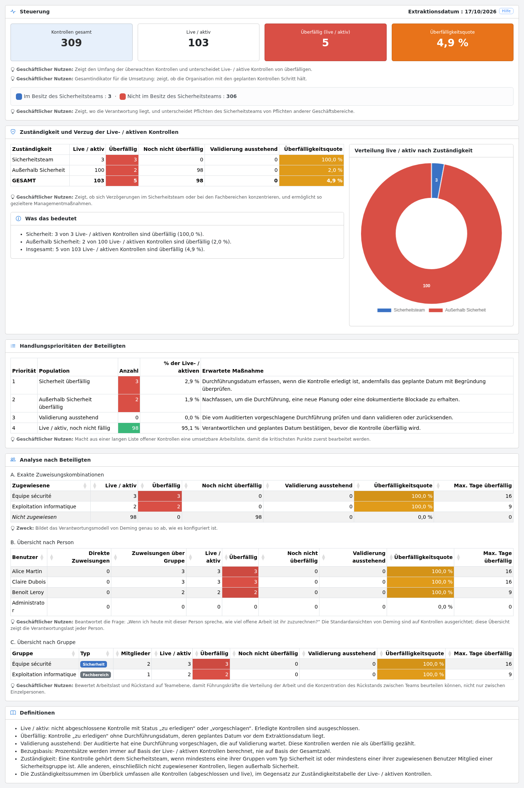
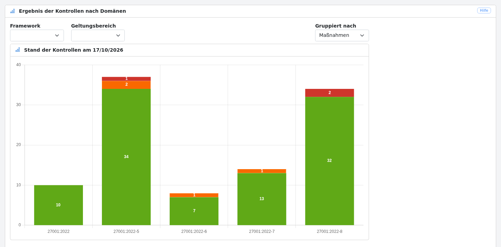
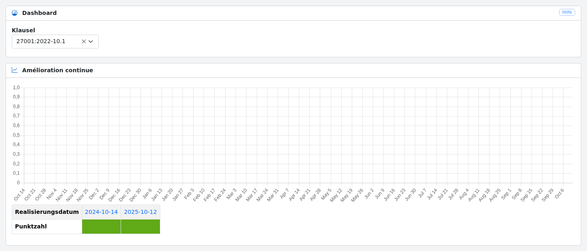
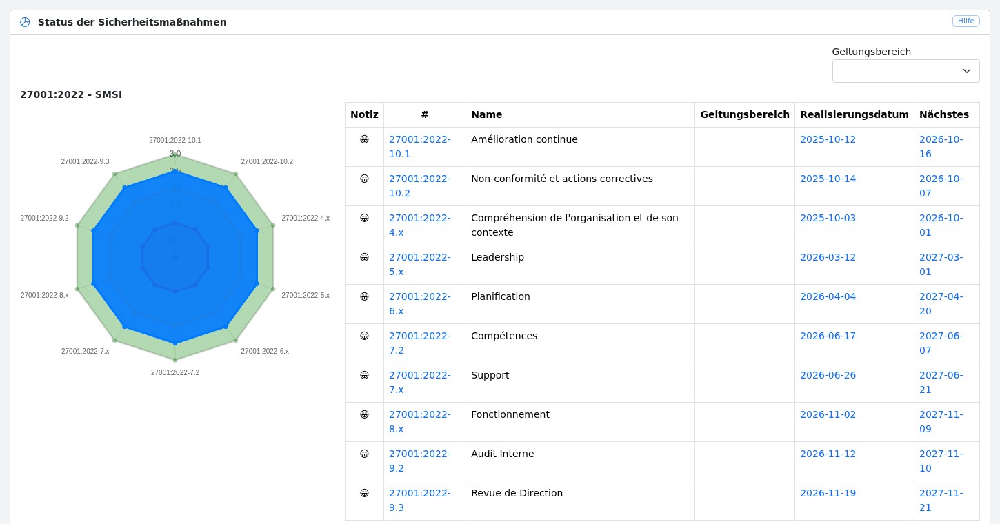
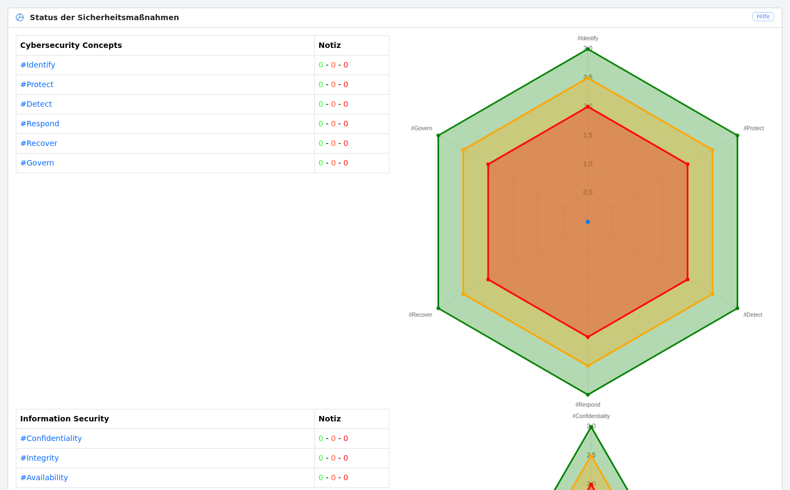
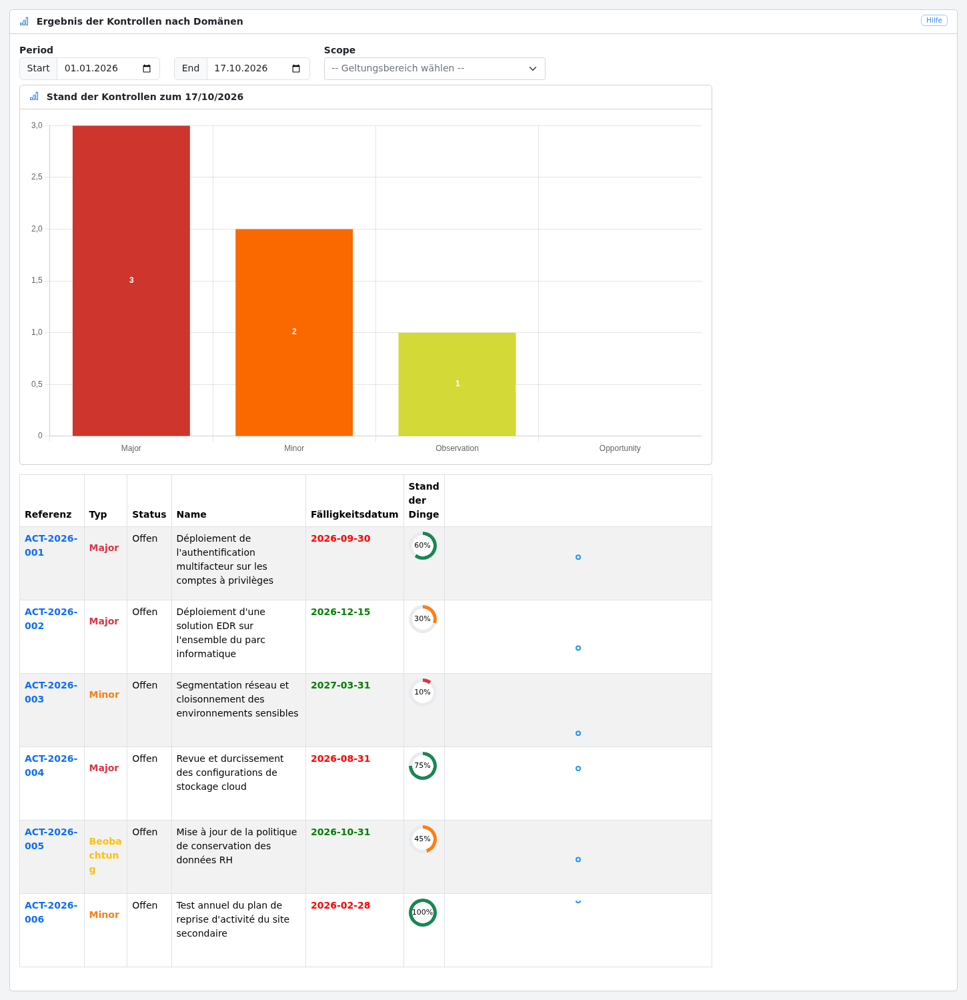

# Dashboards

Das Menü „Analyse“ bietet Zugriff auf die folgenden Dashboards:

* [Steuerung](#steering): Gesamtverfolgung der laufenden Kontrollen, ihrer Zuständigkeit und ihrer Verspätungen

* [nach Domänen](#domains): Status der Kontrollen nach Domäne

* [nach Maßnahmen](#controls): Historie der Kontrollen einer Sicherheitsmaßnahme

* [nach Kontrollen](#measures): Status der Sicherheitsmaßnahmen jeder Domäne

* [nach Attributen](#attributes): Status der Kontrollen nach Attribut

* [nach Aktionsplänen](#actions): Status der Aktionspläne

## Steuerung {#steering}

Diese Ansicht steht Administratoren, Benutzern und Auditoren zur Verfügung. Sie bietet eine Managementsicht auf die
Kontrollen: wie viele laufen, wie viele verspätet sind, wer für sie zuständig ist und was zuerst zu bearbeiten ist.

Die Ansicht enthält:

* **Überblick**: Gesamtzahl der Kontrollen, Anzahl der laufenden / aktiven Kontrollen, Anzahl der verspäteten
  laufenden Kontrollen und Verspätungsquote. Die Anzahl der Kontrollen, die vom Sicherheitsteam und von den anderen
  Fachbereichen getragen werden, wird ebenfalls angezeigt.

* **Zuständigkeit und Verspätung der laufenden / aktiven Kontrollen**: für die vom Sicherheitsteam und die außerhalb
  des Sicherheitsteams getragenen Kontrollen die Anzahl der laufenden, verspäteten, noch nicht verspäteten und auf
  Validierung wartenden Kontrollen, die Verspätungsquote, ein Diagramm der Verteilung nach Zuständigkeit und eine
  Zusammenfassung in verständlicher Sprache („Was das bedeutet“).

* **Handlungsprioritäten der Beitragenden**: eine nach Priorität geordnete Arbeitsliste (Verspätung Sicherheit,
  Verspätung außerhalb Sicherheit, wartet auf Validierung, noch nicht fällig) mit der erwarteten Aktion für jede Gruppe.

* **Analyse nach Beitragenden**:
    * A. die genauen Zuweisungskombinationen (Benutzer und Gruppen), wie sie in Deming konfiguriert sind,
    * B. eine Zusammenfassung pro Person, die direkte Zuweisungen und Zuweisungen über eine Gruppe unterscheidet,
    * C. eine Zusammenfassung pro Gruppe mit ihrem Typ (Fachbereich oder Sicherheit) und ihrer Mitgliederzahl.

* **Definitionen** der in der Ansicht verwendeten Indikatoren.

Die Zuständigkeit für eine Kontrolle ergibt sich aus dem [Gruppentyp](config.de.md#groups): Eine Kontrolle wird vom
Sicherheitsteam getragen, wenn mindestens eine ihrer Gruppen vom Typ *Sicherheit* ist oder wenn mindestens einer ihrer
zugewiesenen Benutzer Mitglied einer Gruppe *Sicherheit* ist. Alle anderen Kontrollen, einschließlich der nicht
zugewiesenen, liegen außerhalb des Sicherheitsteams.

Alle Zahlen berücksichtigen den Schalter „Meine Daten / Alle Daten“ der Werkzeugleiste.

## Nach Domänen {#domains}

Diese Ansicht zeigt für jede Domäne die Anzahl der Kontrollen nach Ergebnis (grün, orange, rot).
Sie kann nach Rahmenwerk und Geltungsbereich gefiltert und nach Maßnahme oder nach Kontrolle gruppiert werden.

## Nach Maßnahmen {#controls}

Diese Ansicht zeigt die Historie der Kontrollen einer über ihre Klausel ausgewählten Sicherheitsmaßnahme.

## Nach Kontrollen {#measures}

Diese Ansicht zeigt für jede Domäne ein Radar mit dem letzten Score jeder Sicherheitsmaßnahme sowie die Liste der
Maßnahmen, das Datum ihrer letzten Durchführung und das Datum der nächsten Kontrolle. Sie kann nach Geltungsbereich
gefiltert werden.

## Nach Attributen {#attributes}

Diese Ansicht zeigt die Ergebnisse der Kontrollen gruppiert nach Attribut.

## Nach Aktionsplänen {#actions}

Diese Ansicht zeigt die Anzahl der Aktionspläne nach Typ (Major, Minor, Beobachtung, Gelegenheit) über einen
Zeitraum, mit der Liste der Aktionspläne und ihrem Fortschritt. Sie kann nach Geltungsbereich gefiltert werden.

