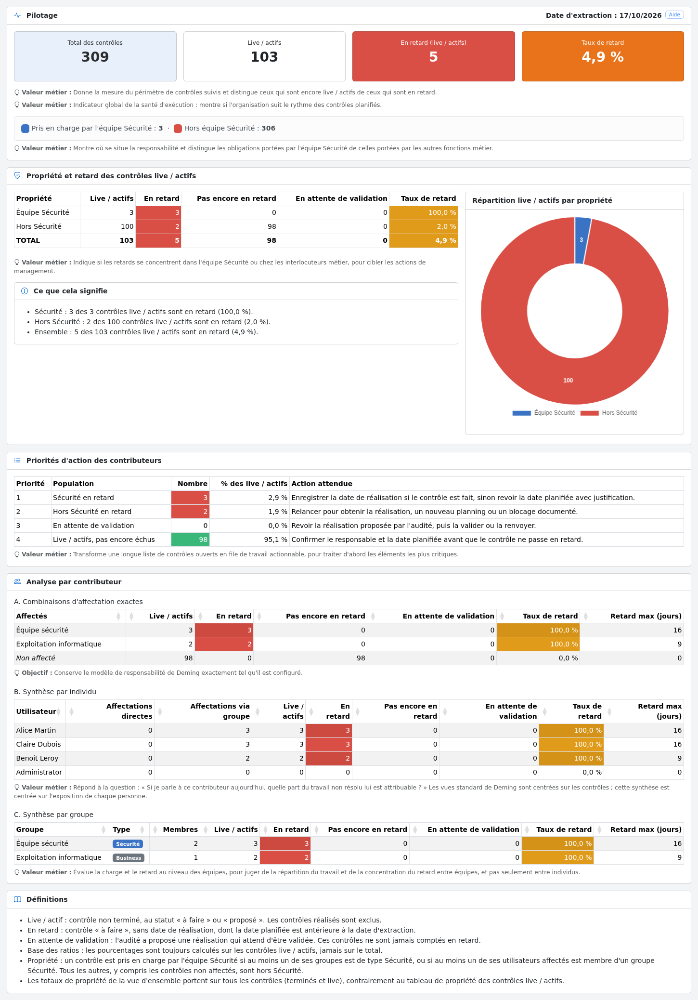
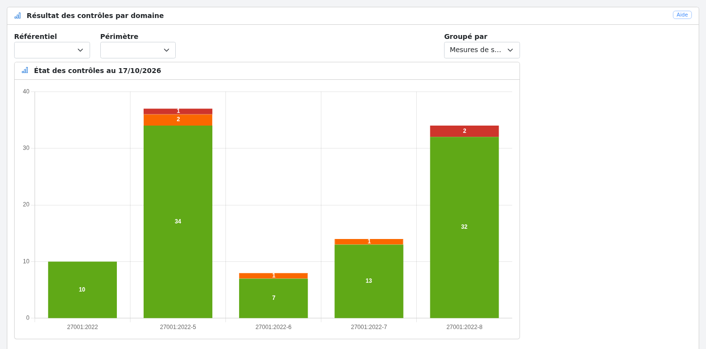
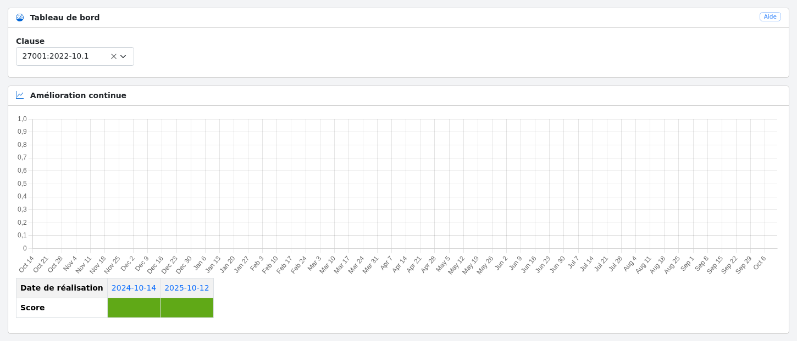
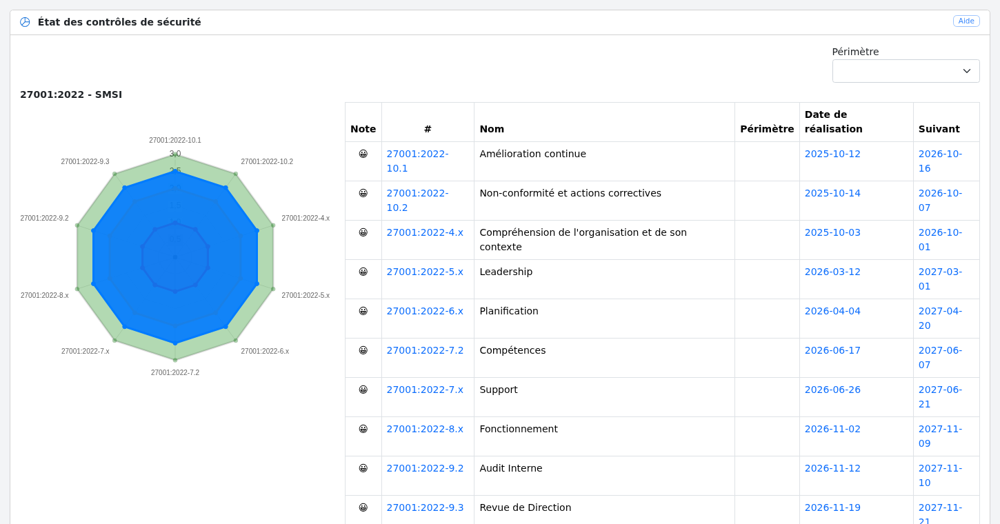
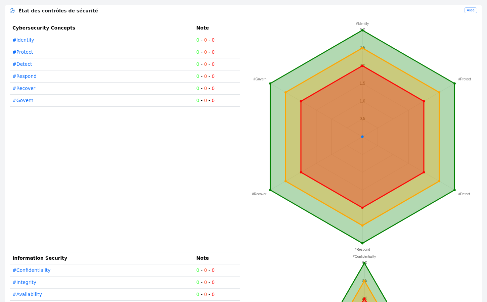
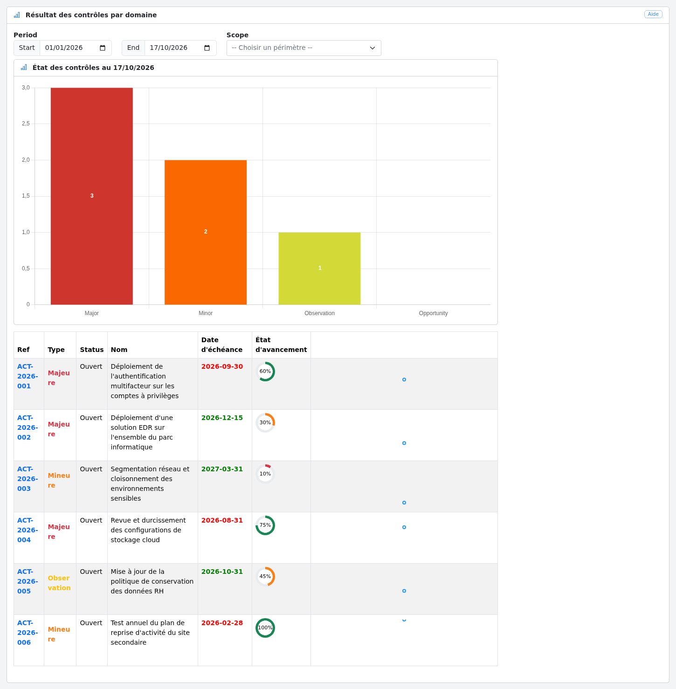

# Tableaux de bord

Le menu « Analyse » donne accès aux tableaux de bord suivants :

* [Pilotage](#steering) : suivi global des contrôles live, de leur propriété et de leurs retards

* [par domaines](#domains) : état des contrôles par domaine

* [par mesure](#controls) : historique des contrôles d'une mesure de sécurité

* [par contrôles](#measures) : état des mesures de sécurité de chaque domaine

* [par attributs](#attributes) : état des contrôles par attribut

* [par plans d'actions](#actions) : état des plans d'action

## Pilotage {#steering}

Cet écran est accessible aux administrateurs, utilisateurs et auditeurs. Il donne une vue de management des
contrôles : combien sont en cours, combien sont en retard, qui en est responsable et ce qu'il faut traiter en premier.

L'écran contient :

* **Vue d'ensemble** : nombre total de contrôles, nombre de contrôles live / actifs, nombre de contrôles live
  en retard et taux de retard. Le nombre de contrôles portés par l'équipe Sécurité et par les autres fonctions métier
  est également affiché.

* **Propriété et retard des contrôles live / actifs** : pour les contrôles pris en charge par l'équipe Sécurité et
  hors Sécurité, le nombre de contrôles live, en retard, pas encore en retard et en attente de validation, le taux de
  retard, un graphique de répartition par propriété et une synthèse en langage clair (« Ce que cela signifie »).

* **Priorités d'action des contributeurs** : une file de travail ordonnée par priorité (retard Sécurité, retard hors
  Sécurité, en attente de validation, pas encore échus) avec l'action attendue pour chaque population.

* **Analyse par contributeur** :
    * A. les combinaisons d'affectation exactes (utilisateurs et groupes) telles que configurées dans Deming,
    * B. une synthèse par individu, distinguant les affectations directes et les affectations via un groupe,
    * C. une synthèse par groupe, avec son type (Business ou Sécurité) et son nombre de membres.

* **Définitions** des indicateurs utilisés dans l'écran.

La propriété d'un contrôle est déduite du [type de groupe](config.md#groups) : un contrôle est pris en charge par
l'équipe Sécurité si au moins un de ses groupes est de type *Sécurité*, ou si au moins un de ses utilisateurs affectés
est membre d'un groupe *Sécurité*. Tous les autres contrôles, y compris ceux non affectés, sont hors Sécurité.

Tous les chiffres tiennent compte de la bascule « mes données / toutes les données » de la barre d'outils.

## Par domaines {#domains}

Cet écran affiche, pour chaque domaine, le nombre de contrôles par résultat (vert, orange, rouge).
Il peut être filtré par référentiel et par périmètre, et regroupé par mesure ou par contrôle.

## Par mesure {#controls}

Cet écran affiche l'historique des contrôles d'une mesure de sécurité sélectionnée par sa clause.

## Par contrôles {#measures}

Cet écran affiche, pour chaque domaine, un radar du dernier score de chaque mesure de sécurité ainsi que la liste
des mesures, la date de leur dernière réalisation et la date du prochain contrôle. Il peut être filtré par périmètre.

## Par attributs {#attributes}

Cet écran affiche les résultats des contrôles regroupés par attribut.

## Par plans d'actions {#actions}

Cet écran affiche le nombre de plans d'action par type (majeur, mineur, observation, opportunité) sur une période,
avec la liste des plans d'action et leur avancement. Il peut être filtré par périmètre.

