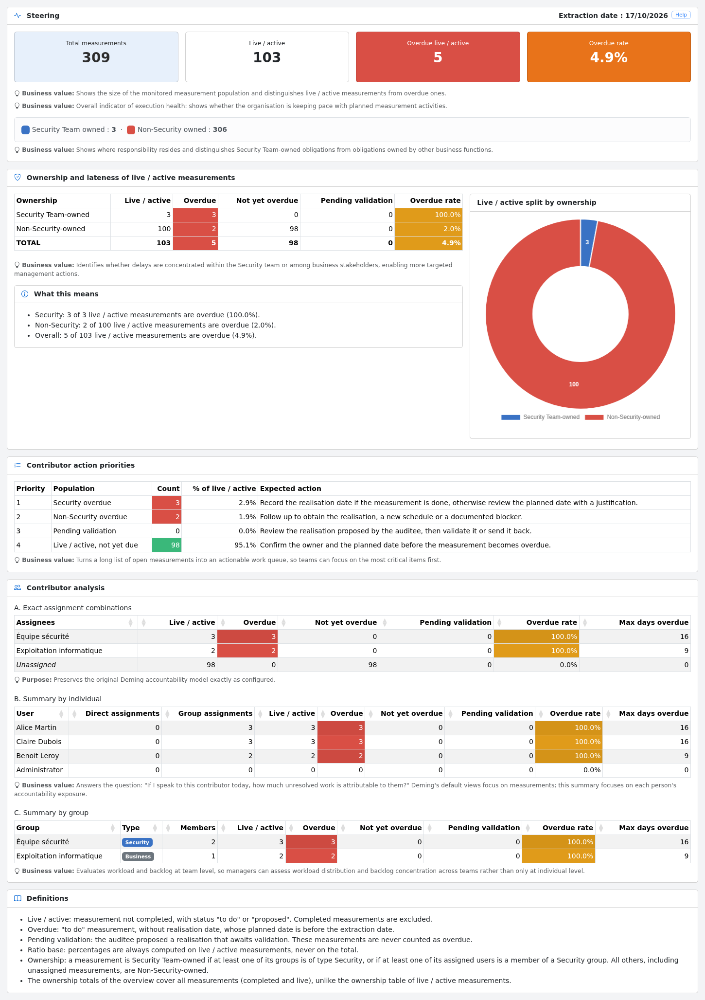
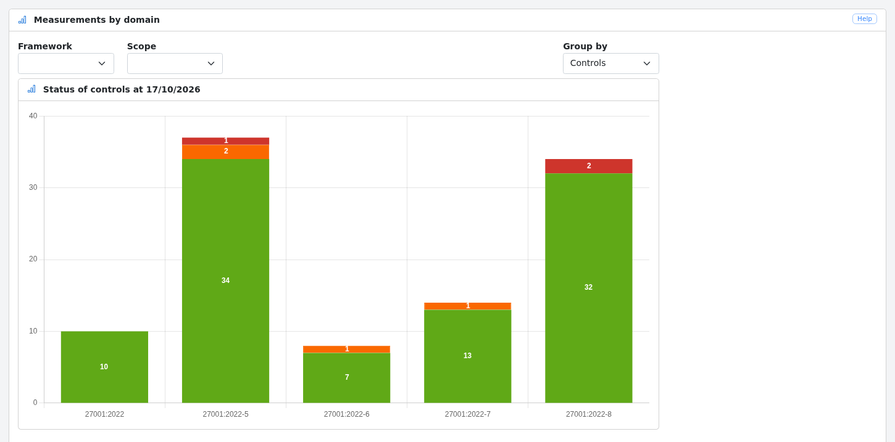
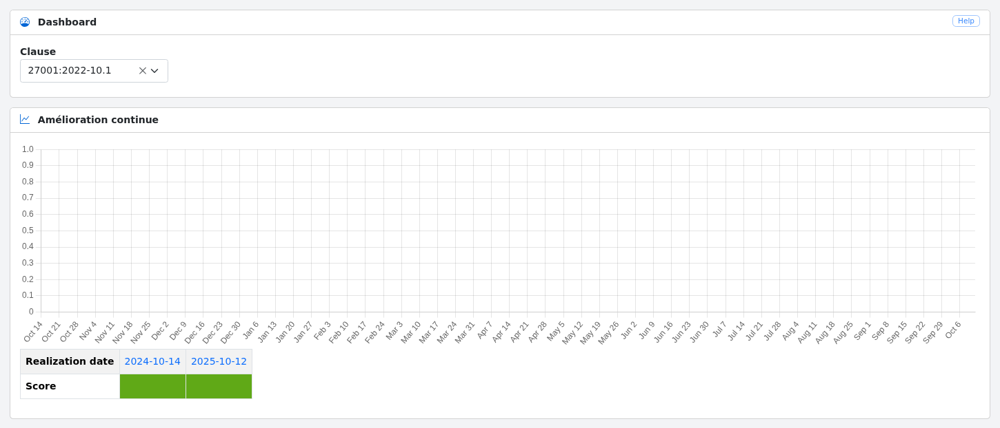
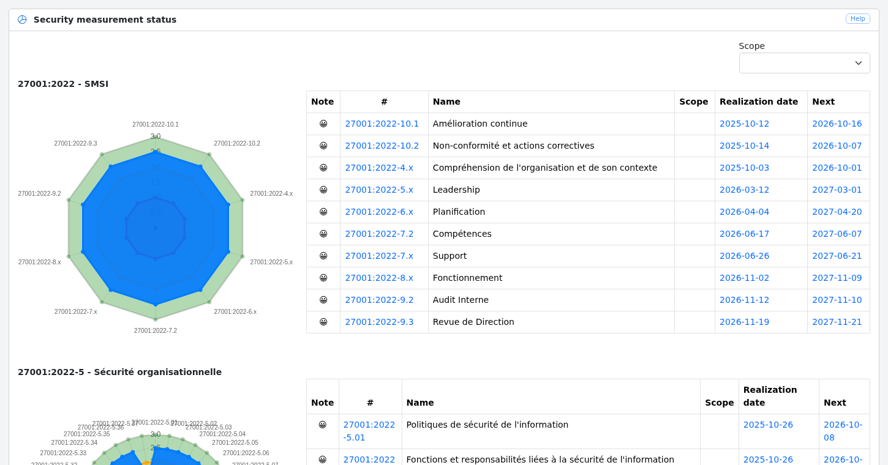
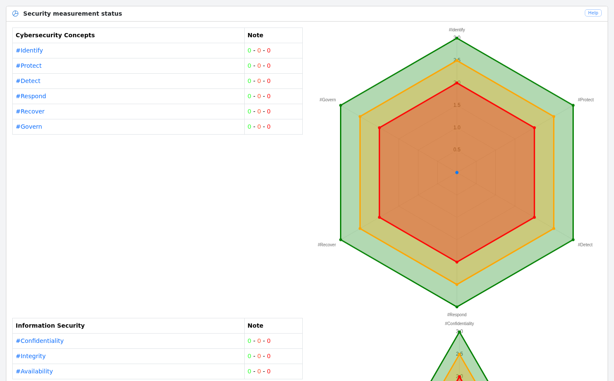
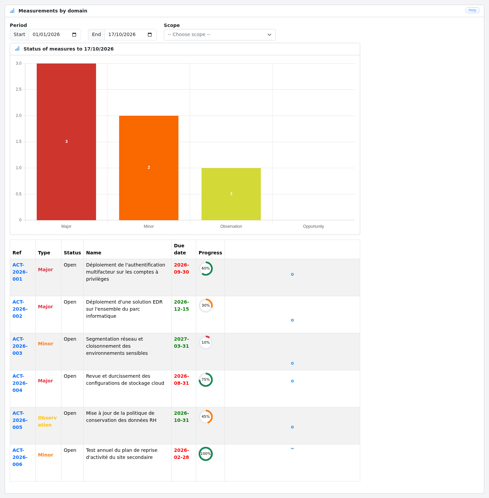

# Dashboards

The "Analysis" menu gives access to the following dashboards:

* [Steering](#steering): overall follow-up of live measurements, ownership and lateness

* [by domains](#domains): status of the measurements by domain

* [by controls](#controls): history of the measurements of a control

* [by measures](#measures): status of the controls of each domain

* [by attributes](#attributes): status of the measurements by attribute

* [by action plans](#actions): status of the action plans

## Steering {#steering}

This screen is available to administrators, users and auditors. It gives a management view of the measurements:
how many are live, how many are late, who owns them and what should be done first.

The screen contains:

* **Overview**: total number of measurements, number of live / active measurements, number of overdue
  live measurements and overdue rate. The number of measurements owned by the Security team and by the other
  business functions is also displayed.

* **Ownership and lateness of live / active measurements**: for Security Team-owned and Non-Security-owned
  measurements, the number of live, overdue, not yet overdue and pending validation measurements, the overdue rate,
  a chart of the split by ownership and a plain-language summary ("What this means").

* **Contributor action priorities**: a work queue ordered by priority (Security overdue, Non-Security overdue,
  pending validation, not yet due) with the expected action for each population.

* **Contributor analysis**:
    * A. the exact assignment combinations (users and groups) as configured in Deming,
    * B. a summary by individual, counting direct assignments and assignments through a group,
    * C. a summary by group, with its type (Business or Security) and its number of members.

* **Definitions** of the indicators used on the screen.

The ownership of a measurement is derived from the [group type](config.md#groups): a measurement is Security
Team-owned if at least one of its groups is of type *Security*, or if at least one of its assigned users is a
member of a *Security* group. All other measurements, including unassigned ones, are Non-Security-owned.

All figures take into account the "my data / all data" switch of the toolbar.

## By domains {#domains}

This screen displays, for each domain, the number of measurements by result (green, orange, red).
It can be filtered by framework and scope, and grouped by control or by measurement.

## By controls {#controls}

This screen displays the history of the measurements of a control selected by its clause.

## By measures {#measures}

This screen displays, for each domain, a radar of the last score of each control together with the list of
controls, their last realization date and their next planned date. It can be filtered by scope.

## By attributes {#attributes}

This screen displays the measurement results grouped by attribute.

## By action plans {#actions}

This screen displays the number of action plans by type (major, minor, observation, opportunity) over a period,
with the list of action plans and their progress. It can be filtered by scope.

