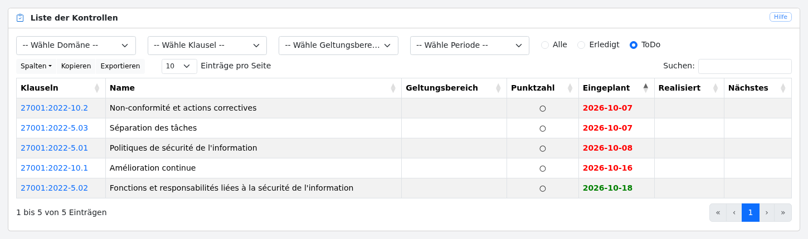
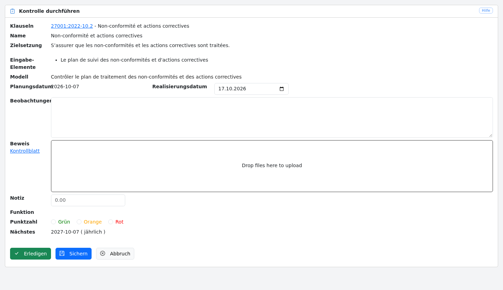
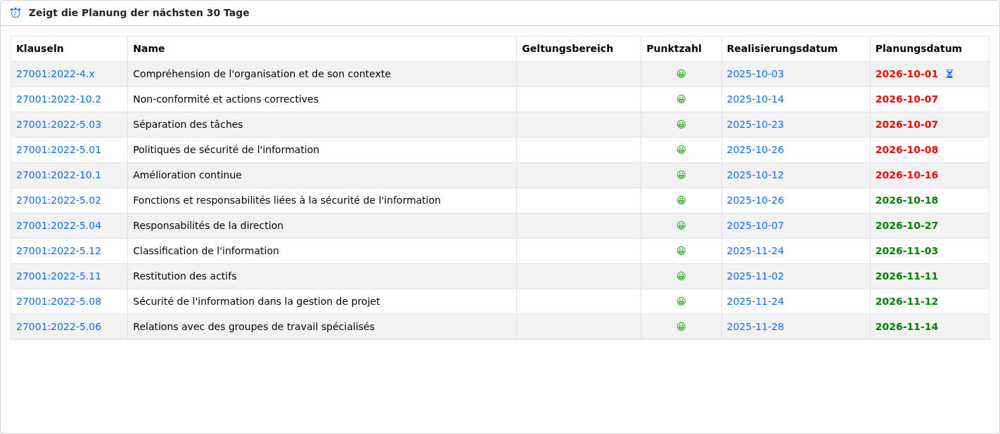
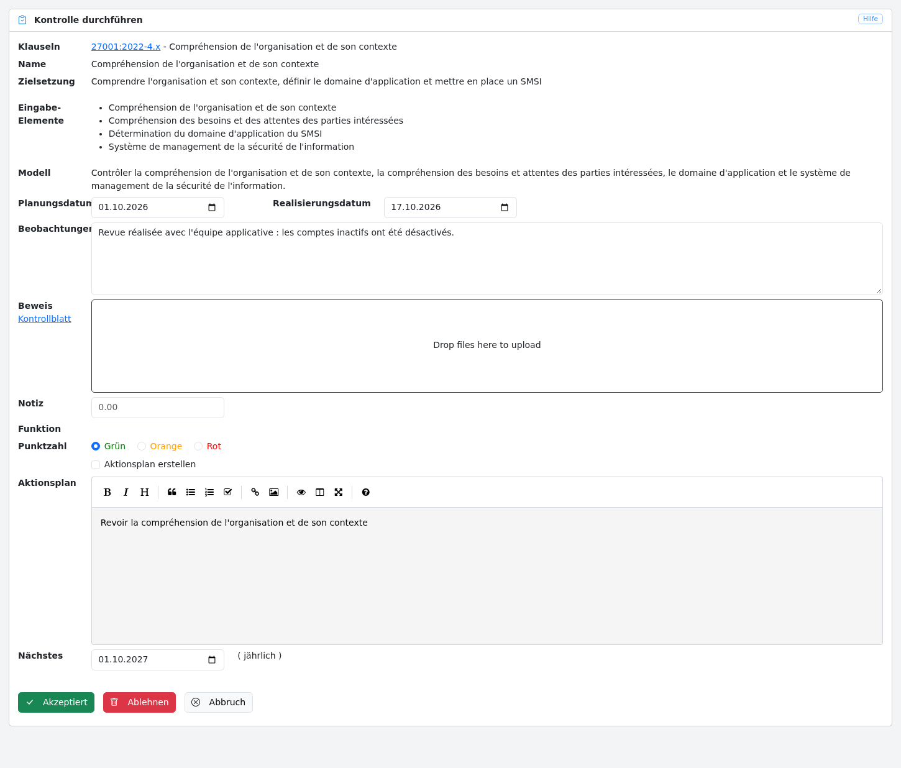

# Delegation

Deming ermöglicht es, die Durchführung von Sicherheitskontrollen an Benutzer mit der Rolle *Auditierte* zu delegieren.
Die Rolle Auditierte wird einem Benutzer über die [Benutzerverwaltung](config.de.md#users) zugewiesen.

Diese Delegation folgt diesen Regeln:

- Die Auditierten werden regelmäßig per E-Mail über die durchzuführenden Kontrollen informiert;
- Die Auditierten sehen nur die Kontrollen, die ihnen zugewiesen sind, und die Kontrollen, die sie zuvor durchgeführt haben;
- Die Benutzer können eine von einem Auditierten durchgeführte Kontrolle akzeptieren oder ablehnen;
- Wird eine Kontrolle abgelehnt, kehrt sie in die Liste der vom Auditierten durchzuführenden Kontrollen zurück.

## Liste der durchzuführenden Kontrollen

Aus Sicht des Auditierten berücksichtigt das Dashboard der Startseite nur die ihm zugewiesenen Kontrollen, und das Menü
„Kontrollen“ öffnet die Liste dieser Kontrollen.

Der Auditierte kann:

- die Liste der Kontrollen durchsuchen
- die Kontrollen nach Domäne, Klausel, Geltungsbereich oder Zeitraum filtern
- die Liste nach jeder Spalte sortieren
- eine durchzuführende Kontrolle auswählen

## Eine Kontrolle durchführen

Wenn ein Auditierter eine Kontrolle durchführt, kann er:

- die Kontrolle sichern

- die Kontrolle erledigen

Wenn er klickt auf:

- „Erledigen“: Seine Änderungen werden gesichert und die Kontrolle wechselt in den Status „zu validieren“. Aus Sicht des Auditierten befindet sich die Kontrolle in der Liste der durchgeführten Kontrollen.

- „Sichern“: Seine Änderungen werden gesichert, die Kontrolle bleibt in der Liste der durchzuführenden Kontrollen.

- „Abbruch“: Die Änderungen werden nicht gesichert, der Benutzer kehrt zur Ansicht der Kontrolle zurück.

## Eine Kontrolle akzeptieren / ablehnen

Sobald eine Kontrolle von einem Auditierten durchgeführt wurde, wechselt sie in den Status „zu validieren“.

Für die anderen Benutzer wird dies durch eine Sanduhr neben dem Planungsdatum in der Liste der in den nächsten 30 Tagen
geplanten Kontrollen auf der Startseite und neben dem Durchführungsdatum in der [Liste der Kontrollen](controls.de.md#list)
angezeigt:

Wenn der Benutzer auf die Sanduhr klickt, gelangt er zu der vom Auditierten durchgeführten Kontrolle.

Er kann die Kontrolle dann akzeptieren oder ablehnen, indem er eine Notiz in den Beobachtungen der Kontrolle hinzufügt und, je nach Ergebnis der Kontrolle, einen Aktionsplan und ein Datum für die Überprüfung der Kontrolle vorschlägt.

Wenn der Benutzer klickt auf:

- „Akzeptiert“: Die geänderten Daten werden gesichert und eine neue Kontrolle wird zum eingegebenen Planungsdatum erstellt.

- „Ablehnen“: Die geänderten Daten werden gesichert und die Kontrolle wird in die Liste der vom Auditierten durchzuführenden Kontrollen zurückgeschickt.

- „Abbruch“: Der Benutzer kehrt zur Ansicht der Kontrolle zurück.
