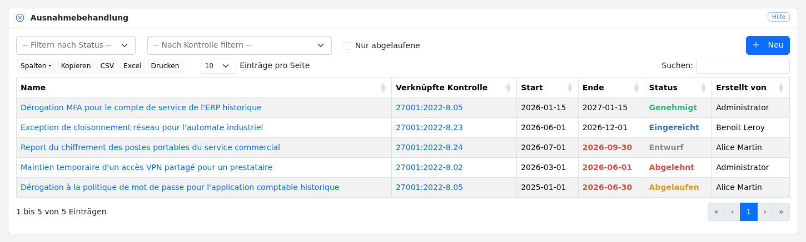
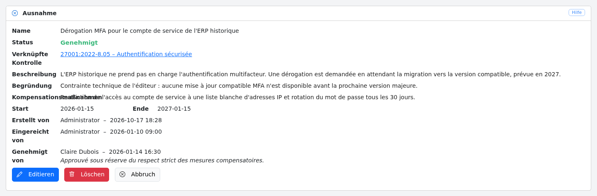
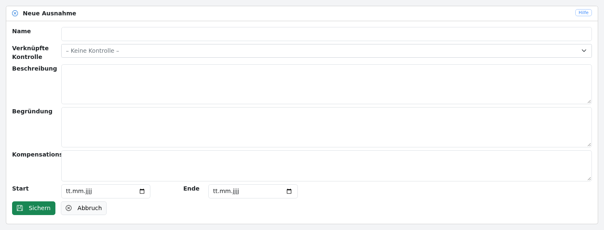
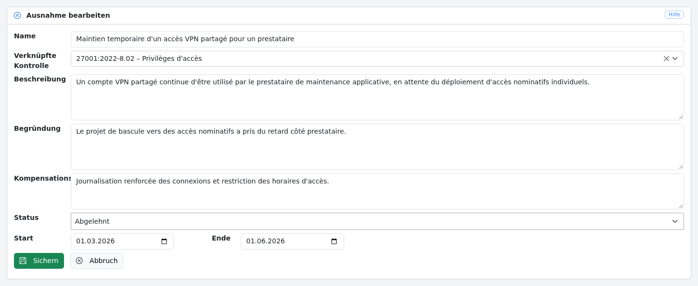

# Ausnahmen

Die Ausnahmebehandlung ermöglicht es, Abweichungen formell zu erfassen und zu verfolgen, die gewährt werden, wenn eine Sicherheitsmaßnahme nicht gemäß den Anforderungen umgesetzt werden kann. Eine Ausnahme ist mit einer nicht konformen Sicherheitsmaßnahme verknüpft und durchläuft einen Genehmigungsworkflow, der von einem Administrator bearbeitet wird.

## Liste der Ausnahmen {#list}

Diese Ansicht zeigt die Liste der Ausnahmen an und ermöglicht es, sie zu filtern nach:

* Status (Entwurf, Eingereicht, Genehmigt, Abgelehnt, Abgelaufen);

* verknüpfter Kontrolle;

* nur abgelaufenen Ausnahmen.

[](images/ex1.de.png)

Überschrittene Enddaten werden rot angezeigt.

Durch Klicken auf eine Zeile gelangen Sie zur [Detailansicht der Ausnahme](#show).

Die Schaltfläche „Neu“ steht Benutzern mit der Rolle **Administrator** oder **User** zur Verfügung.

## Eine Ausnahme anzeigen {#show}

Diese Ansicht zeigt die Informationen einer Ausnahme:

* den Namen der Ausnahme;

* den aktuellen Status;

* die verknüpfte Kontrolle (mit einem Link zur entsprechenden [Sicherheitsmaßnahme](measures.de.md#show));

* die Beschreibung der Ausnahme;

* die geschäftliche Begründung;

* eventuelle Kompensationsmaßnahmen;

* den Gültigkeitszeitraum (Start- und Enddatum);

* den Ersteller und das Erstellungsdatum;

* den Einreicher und das Einreichungsdatum;

* die Entscheidung (Genehmiger, Datum und Kommentar).

[](images/ex2.de.png)

Die verfügbaren Schaltflächen hängen vom Status der Ausnahme und von der Rolle des Benutzers ab:

| Schaltfläche | Bedingung |
|---|---|
| „Absenden“ | Status Entwurf — Administrator oder User |
| „Editieren“ | Status Entwurf oder Abgelehnt — Administrator oder User |
| „Löschen“ | nur Administrator |
| „Genehmigen“ | Status Eingereicht — nur Administrator |
| „Ablehnen“ | Status Eingereicht — nur Administrator |

Wenn Sie klicken auf:

* „Absenden“, wechselt die Ausnahme in den Status *Eingereicht* und wird einem Administrator zur Genehmigung vorgelegt;

* „Editieren“, gelangen Sie zur [Ansicht zum Ändern der Ausnahme](#edit);

* „Löschen“, wird die Ausnahme gelöscht und Sie kehren zur [Liste der Ausnahmen](#list) zurück;

* „Genehmigen“, wird die Ausnahme angenommen und wechselt in den Status *Genehmigt*;

* „Ablehnen“, wird die Ausnahme abgelehnt (ein Grund ist erforderlich) und wechselt in den Status *Abgelehnt*;

* „Abbruch“, kehren Sie zur [Liste der Ausnahmen](#list) zurück.

## Eine Ausnahme erstellen {#create}

In der [Liste der Ausnahmen](#list) öffnet die Schaltfläche „Neu“ das Erstellungsformular.

[](images/ex3.de.png)

Diese Ansicht enthält die folgenden Felder:

* den Namen der Ausnahme;

* die verknüpfte Kontrolle (die nicht konforme Sicherheitsmaßnahme, die Anlass der Ausnahme ist);

* die Beschreibung der Ausnahme;

* die geschäftliche Begründung (der Grund, warum die Maßnahme nicht umgesetzt werden kann);

* die Kompensationsmaßnahmen (alternative Maßnahmen, die eingeführt werden, um das Restrisiko zu verringern);

* das Start- und Enddatum der Gültigkeit.

Eine Ausnahme wird mit dem Status **Entwurf** erstellt. Sie muss ausdrücklich eingereicht werden, bevor ein Administrator sie prüfen kann.

Wenn Sie klicken auf:

* „Sichern“, wird die Ausnahme gespeichert und Sie gelangen zur [Detailansicht der Ausnahme](#show);

* „Abbruch“, kehren Sie zur [Liste der Ausnahmen](#list) zurück.

## Eine Ausnahme ändern {#edit}

Mit dieser Ansicht kann eine Ausnahme mit dem Status **Entwurf** oder **Abgelehnt** geändert werden. Ein Administrator kann eine Ausnahme unabhängig von ihrem Status ändern.

[](images/ex4.de.png)

Eine abgelehnte Ausnahme, die geändert wird, kehrt automatisch in den Status *Entwurf* zurück, damit sie korrigiert und erneut eingereicht werden kann.

Diese Ansicht enthält dieselben Felder wie die [Erstellungsansicht](#create). Ein Administrator sieht zusätzlich den Status der Ausnahme und kann ihn frei ändern.

Wenn Sie klicken auf:

* „Sichern“, werden die Änderungen gespeichert und Sie gelangen zur [Detailansicht der Ausnahme](#show);

* „Abbruch“, kehren Sie zur [Detailansicht der Ausnahme](#show) zurück.

## Genehmigungsworkflow {#workflow}

Der Lebenszyklus einer Ausnahme folgt diesen Schritten:

```
Entwurf → Eingereicht → Genehmigt
                     ↘ Abgelehnt → (erneut ändern) → Entwurf
Genehmigt → Abgelaufen  (automatisch, wenn das Enddatum überschritten ist)
```

* **Entwurf**: Die Ausnahme wird verfasst. Sie kann geändert oder eingereicht werden.

* **Eingereicht**: Die Ausnahme wartet auf eine Entscheidung. Sie kann nicht mehr geändert werden.

* **Genehmigt**: Die Ausnahme wird für den festgelegten Gültigkeitszeitraum gewährt.

* **Abgelehnt**: Die Ausnahme wird verweigert. Ein Ablehnungsgrund ist erforderlich und für den Antragsteller sichtbar. Die Ausnahme kann korrigiert und erneut eingereicht werden.

* **Abgelaufen**: Eine genehmigte Ausnahme, deren Enddatum überschritten ist, wechselt automatisch in den Status *Abgelaufen*.

!!! note "Nachvollziehbarkeit"
    Jeder Übergang wird mit Zeitstempel versehen und dem Benutzer zugeordnet, der ihn durchgeführt hat. Diese Informationen werden aufbewahrt und in der [Detailansicht der Ausnahme](#show) angezeigt, sodass die Ausnahme bei einem ISO-27001-Audit begründet werden kann.
