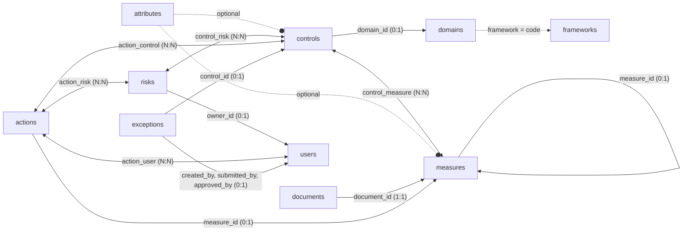
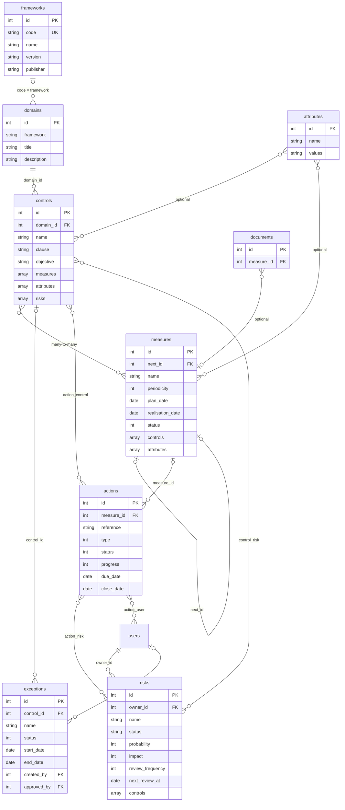

# **Datenmodell**

Die wichtigsten Tabellen sind:

- attributes  
- domains  
- frameworks  
- controls  
- measures  
- documents  
- risks  
- actions  
- exceptions  

> `controls` = **Sicherheitsmaßnahmen** (umzusetzende Anforderungen).  
> `measures` = **Kontrollen** (periodische Überprüfungen dieser Anforderungen).  
> `risks` = **Informationssicherheitsrisiken** (Register nach ISO 27001 §6.1.2).  
> `actions` = **Aktionspläne** (Behebung fehlgeschlagener Kontrollen und von Risiken).  
> `exceptions` = **Ausnahmen** (befristete Abweichungen von einer Sicherheitsmaßnahme).

## **Abhängigkeiten zwischen Tabellen**

Überblick: wer verwendet was.



Das folgende detaillierte Schema beschreibt die Felder jeder Tabelle.



Die Beziehungen sind wie folgt:

| Verknüpfung | Typ | Beschreibung |
| --- | --- | --- |
| `domains` → `controls` | Fremdschlüssel (1:N) | Jede Sicherheitsmaßnahme verweist über `domain_id` auf ihre Domäne |
| `frameworks` → `domains` | Optional (1:N) über den Code | Das Feld `framework` einer Domäne enthält den `code` ihres Rahmenwerks; die Zeile in `frameworks` ergänzt dessen Metadaten |
| `controls` ↔ `measures` | Viele-zu-viele (bidirektional) | Jede Sicherheitsmaßnahme listet ihre Kontrollen in `measures[]`; jede Kontrolle listet ihre Sicherheitsmaßnahmen in `controls[]` |
| `attributes` → `controls` | Optional | Das Feld `attributes` einer Sicherheitsmaßnahme kann eine Liste von Attribut-IDs enthalten |
| `attributes` → `measures` | Optional | Ebenso für die Kontrollen |
| `measures` → `measures` | Selbstreferenz über `next_id` | Ermöglicht die Verkettung aufeinanderfolgender Kampagnen derselben Kontrolle |
| `documents` → `measures` | Optional (1:N) | Dokumente und Nachweise sind über `measure_id` an die Kontrollen angehängt |
| `risks` ↔ `controls` | Viele-zu-viele über `control_risk` | Ein gemindertes Risiko muss mit einer oder mehreren Sicherheitsmaßnahmen verknüpft sein; die Liste wird im Risiko in `controls[]` gespeichert |
| `users` → `risks` | Optional (1:N) | Jedem Risiko kann ein Verantwortlicher (`owner_id`) für die periodische Überprüfung zugewiesen werden |
| `measures` → `actions` | Optional (1:N) | Ein bei der Durchführung einer Kontrolle erstellter Aktionsplan verweist über `measure_id` auf sie |
| `actions` ↔ `controls` | Viele-zu-viele über `action_control` | Vom Aktionsplan betroffene Sicherheitsmaßnahmen (Klauseln) |
| `actions` ↔ `risks` | Viele-zu-viele über `action_risk` | Aktionspläne zur Behandlung eines Risikos; erforderlich für ein *nicht akzeptiertes* Risiko |
| `actions` ↔ `users` | Viele-zu-viele über `action_user` | Verantwortliche des Aktionsplans |
| `controls` → `exceptions` | Optional (1:N) | Jede Ausnahme verweist über `control_id` auf die Sicherheitsmaßnahme, von der sie abweicht |
| `users` → `exceptions` | Optional (1:N) | Ersteller (`created_by`), Einreicher (`submitted_by`) und Prüfer (`approved_by`) der Ausnahme |

> **Hinweis:** Für die Beziehung controls/measures gibt es keine offengelegte Verknüpfungstabelle.  
> Die IDs sind auf beiden Seiten direkt in jedem Objekt enthalten.  
> Die Pivot-Tabelle `control_risk` verknüpft die Risiken mit den Sicherheitsmaßnahmen.  
> Die Pivot-Tabellen `action_control`, `action_risk` und `action_user` verknüpfen die Aktionspläne mit den Sicherheitsmaßnahmen, den Risiken und den Verantwortlichen.

---

## **attributes**

Attribute sind mehrwertige Klassifizierungsreferenzen.  
Jedes Attribut definiert eine Menge von Tags (mit dem Präfix `#`), die Sicherheitsmaßnahmen und Kontrollen zugeordnet werden können.

| Feld | Typ | Beschreibung |
| --- | --- | --- |
| `id` | integer | Eindeutige Kennung (PK) |
| `name` | string | Name der Taxonomie (z. B. *Sicherheitsmaßnahmen*, *Risk_Level*) |
| `values` | string | Durch Leerzeichen getrennte Liste möglicher Werte, jeweils mit dem Präfix `#` (z. B. `#Preventive #Detective #Corrective`) |
| `created_at` | datetime | Erstellungsdatum (ISO 8601, UTC) |
| `updated_at` | datetime | Datum der letzten Änderung |

Beispiel:

```json
{
  "id": 1,
  "name": "Security measures",
  "values": "#Preventive #Detective #Corrective",
  "created_at": "2026-05-17T20:35:52.000000Z",
  "updated_at": "2026-05-17T20:35:52.000000Z"
}
```

---

## **domains**

Domänen gruppieren die Sicherheitsmaßnahmen nach Themenbereich.  
Jede Domäne gehört zu einem regulatorischen oder methodischen Rahmenwerk (`framework`).

| Feld | Typ | Beschreibung |
| --- | --- | --- |
| `id` | integer | Eindeutige Kennung (PK) |
| `framework` | string | Referenzrahmenwerk (z. B. `NIS2`, `Vulnerability Management`) |
| `title` | string | Name der Domäne (z. B. *NIS2 Governance and Steering*) |
| `description` | string | Beschreibung des abgedeckten Bereichs, oft mit Verweis auf einen Artikel oder eine Norm |
| `created_at` | datetime | Erstellungsdatum |
| `updated_at` | datetime | Datum der letzten Änderung |

Beispiel:

```json
{
  "id": 1,
  "framework": "NIS2",
  "title": "NIS2 Governance and Steering",
  "description": "Strategic and operational steering according to Art. 21.1 and 21.2.a",
  "created_at": "2026-05-17T20:35:52.000000Z",
  "updated_at": "2026-05-17T20:35:52.000000Z"
}
```

---

## **frameworks**

Die Tabelle `frameworks` ergänzt die in `domains.framework` verwendeten Rahmenwerkscodes um Metadaten. Sie ersetzt dieses
Feld nicht: Ein Rahmenwerk ist über seinen `code` mit seinen Domänen und über diese mit seinen Sicherheitsmaßnahmen verknüpft.
Eine Zeile wird automatisch mit dem Code als Namen angelegt, wenn eine Domäne mit einem neuen Rahmenwerkscode gespeichert
wird. Die [Zuordnungen](crosswalk.de.md) verwenden diese Codes, um Quell- und Zielrahmenwerk auszuwählen.

| Feld | Typ | Beschreibung |
| --- | --- | --- |
| `id` | integer | Eindeutige Kennung (PK) |
| `code` | string | Code des Rahmenwerks, identisch mit `domains.framework` (eindeutig, z. B. `27001:2022`) |
| `name` | string | Name des Rahmenwerks (standardmäßig der Code) |
| `version` | string | Version des Rahmenwerks (standardmäßig leer) |
| `publisher` | string | Herausgeber des Rahmenwerks (standardmäßig leer) |
| `jurisdiction` | string \| null | Rechtsraum, in dem das Rahmenwerk gilt |
| `source_url` | string \| null | URL der offiziellen Quelle |
| `status` | string \| null | Status des Rahmenwerks (Freitext) |
| `publication_date` | date \| null | Veröffentlichungsdatum |
| `effective_date` | date \| null | Datum des Inkrafttretens |
| `notes` | string \| null | Freie Notizen |
| `created_at` | datetime | Erstellungsdatum |
| `updated_at` | datetime | Datum der letzten Änderung |

Beispiel:

```json
{
  "id": 2,
  "code": "NIS2-ReCyF-2.5-FR",
  "name": "ReCyF 2.5",
  "version": "2.5",
  "publisher": "ANSSI",
  "jurisdiction": "France",
  "source_url": "https://messervices.cyber.gouv.fr/nis2#exigences",
  "status": null,
  "publication_date": null,
  "effective_date": null,
  "notes": null
}
```

---

## **controls**

Sicherheitsmaßnahmen beschreiben die umzusetzenden Anforderungen.  
Jede Sicherheitsmaßnahme gehört zu einer Domäne und wird durch eine oder mehrere Kontrollen überprüft.

| Feld | Typ | Beschreibung |
| --- | --- | --- |
| `id` | integer | Eindeutige Kennung (PK) |
| `domain_id` | integer | Verweis auf `domains.id` (FK, Pflichtfeld) |
| `name` | string | Name der Sicherheitsmaßnahme, oft mit Artikelnummer (z. B. *Art.21.2.a – Risk Analysis*) |
| `clause` | string | Kurzkennung der normativen Klausel (z. B. `NIS2-Art.21.2.a`) |
| `objective` | string | Erwartetes Ziel dieser Sicherheitsmaßnahme |
| `input` | string \| null | Für die Umsetzung erforderliche Daten oder Ressourcen |
| `model` | string \| null | Empfohlenes Betriebsmodell oder empfohlene Methode |
| `indicator` | string \| null | Strukturierter Leistungsindikator (Ziel, Häufigkeit, Verantwortlicher) |
| `action_plan` | string \| null | Zugehöriger Aktions- oder Behandlungsplan |
| `attributes` | array \| null | Liste der zugeordneten Attribut-IDs; `null`, wenn keine |
| `measures` | array | Liste der IDs der Kontrollen, die diese Sicherheitsmaßnahme überprüfen |
| `created_at` | datetime | Erstellungsdatum |
| `updated_at` | datetime | Datum der letzten Änderung |

Beispiel:

```json
{
  "id": 1,
  "domain_id": 1,
  "name": "Art.21.2.a - Risk Analysis",
  "clause": "NIS2-Art.21.2.a",
  "objective": "Assessment of threats to critical assets using EBIOS RM or equivalent methodology",
  "input": "List of critical assets, EBIOS RM methodology",
  "model": "Annual analysis according to ISO 27005 or EBIOS RM",
  "indicator": "Target: Residual score ≤ acceptable | Frequency: Annual | Owner: CISO",
  "action_plan": "Risk treatment plan approved by Management",
  "attributes": null,
  "measures": [1]
}
```

---

## **measures**

Kontrollen beschreiben periodische operative Überprüfungen.  
Eine Kontrolle prüft, ob eine oder mehrere Sicherheitsmaßnahmen ordnungsgemäß angewendet werden.  
Sie enthält Planungs-, Durchführungs- und Ergebnisdaten.

| Feld | Typ | Beschreibung |
| --- | --- | --- |
| `id` | integer | Eindeutige Kennung (PK) |
| `name` | string | Titel der Überprüfung |
| `objective` | string \| null | Spezifisches Ziel dieser Kontrolle |
| `input` | string \| null | Für die Durchführung erforderliche Daten oder Nachweise |
| `model` | string \| null | Vorgehensweise |
| `action_plan` | string \| null | Korrekturmaßnahmen, wenn die Kontrolle fehlschlägt |
| `periodicity` | integer \| null | Häufigkeit in Monaten (z. B. `12` = jährlich, `3` = quartalsweise) |
| `plan_date` | date \| null | Geplantes Durchführungsdatum (`YYYY-MM-DD`) |
| `realisation_date` | date \| null | Tatsächliches Durchführungsdatum |
| `observations` | string \| null | Freie Kommentare zum Ergebnis |
| `score` | number \| null | Numerischer Score der Bewertung; `null`, wenn noch nicht durchgeführt |
| `note` | number \| null | Zusätzliche qualitative Note |
| `status` | integer | Aktueller Status der Kontrolle (siehe unten) |
| `next_id` | integer \| null | ID der nächsten Kontrolle in der historischen Kette (Selbst-FK) |
| `attributes` | array \| null | Liste der zugeordneten Attribut-IDs; `null`, wenn keine |
| `scope` | string \| null | Geltungsbereich (Einheit, Standort, System) |
| `controls` | array | Liste der IDs der von dieser Kontrolle überprüften Sicherheitsmaßnahmen |
| `created_at` | datetime | Erstellungsdatum |
| `updated_at` | datetime | Datum der letzten Änderung |

### **Werte des Feldes `status`**

| Wert | Bedeutung |
| --- | --- |
| `0` | Zu erledigen / noch nicht durchgeführt (`realisation_date` ist null) |
| `1` | Vorgeschlagen (der Auditierte hat ein Ergebnis eingereicht, Validierung ausstehend) |
| `2` | Erledigt / abgeschlossen (`realisation_date` ist gesetzt) |

Beispiel:

```json
{
  "id": 1,
  "name": "Formal review and signature of the risk analysis",
  "objective": "Management validation of the risk treatment strategy",
  "model": "Executive Committee presentation + formal signature",
  "periodicity": 12,
  "plan_date": "2026-07-31",
  "realisation_date": "2025-03-25",
  "score": null,
  "status": 2,
  "next_id": null,
  "attributes": null,
  "scope": null,
  "controls": [1]
}
```

---

## **documents**

Die Tabelle `documents` speichert die Anhänge und dokumentarischen Nachweise der Kontrollen.  
Jedes Dokument ist über `measure_id` mit einem Datensatz `measures` verknüpft.

---

## **risks**

Die Risikoliste erfasst die Informationssicherheitsrisiken gemäß ISO 27001:2022 §6.1.2 und §8.2.  
Jedes Risiko wird nach einer konfigurierbaren Bewertungsmethode bewertet, optional einem Verantwortlichen zugewiesen und einem periodischen Überprüfungszyklus unterzogen.  
Ein Risiko mit Status *Gemindert* muss über die Pivot-Tabelle `control_risk` mit mindestens einer Sicherheitsmaßnahme verknüpft sein.

| Feld | Typ | Beschreibung |
| --- | --- | --- |
| `id` | integer | Eindeutige Kennung (PK) |
| `name` | string | Kurze, eindeutige Bezeichnung des Risikos (Pflichtfeld) |
| `description` | string \| null | Ausführliche Beschreibung des Risikos |
| `owner_id` | integer \| null | Verweis auf `users.id` — für die periodische Überprüfung verantwortliche Person |
| `probability` | integer | Wahrscheinlichkeitsstufe (1 bis N, Standardformeln) oder Bedrohungsstufe bei der Formel MONARC |
| `probability_comment` | string \| null | Freier Kommentar zur Bewertung der Wahrscheinlichkeit |
| `impact` | integer | Schweregrad, wenn das Risiko eintritt (1 bis N) |
| `impact_comment` | string \| null | Freier Kommentar zur Bewertung der Auswirkung |
| `exposure` | integer \| null | Erreichbarkeit des Systems (nur Formel BSI 200-3: 0 = offline, 1 = intern, 2 = Internet) |
| `vulnerability` | integer \| null | Ausnutzbarkeit bekannter Schwachstellen (Formel BSI 200-3) oder Verwundbarkeitsstufe (Formel MONARC) |
| `residual_risk` | integer \| null | Manuell eingegebenes Restrisiko (nur Formel MONARC) |
| `status` | enum | Behandlungsentscheidung (siehe Werte unten) |
| `status_comment` | string \| null | Freier Kommentar zur Behandlungsentscheidung |
| `review_frequency` | integer | Intervall in Monaten zwischen zwei Überprüfungen (Standard: 12) |
| `next_review_at` | date \| null | Geplantes Datum der nächsten Überprüfung |
| `controls` | array | Liste der mit diesem Risiko verknüpften Sicherheitsmaßnahmen-IDs (über `control_risk`) |
| `created_at` | datetime | Erstellungsdatum |
| `updated_at` | datetime | Datum der letzten Änderung |
| `deleted_at` | datetime \| null | Datum der logischen Löschung |

### **Werte des Feldes `status`**

| Wert | Bedeutung |
| --- | --- |
| `not_evaluated` | Noch nicht bewertet |
| `not_accepted` | Nicht akzeptiert — ein verknüpfter Aktionsplan ist erforderlich |
| `temporarily_accepted` | Vorläufig akzeptiert |
| `accepted` | Akzeptiert |
| `mitigated` | Gemindert — mindestens eine verknüpfte Sicherheitsmaßnahme ist erforderlich |
| `transferred` | Übertragen (Versicherung, Dritte) |
| `avoided` | Vermieden |

Beispiel:

```json
{
  "id": 1,
  "name": "Unauthorised access to sensitive data",
  "description": "Risk of data exfiltration via compromised credentials.",
  "owner_id": 3,
  "probability": 3,
  "impact": 4,
  "exposure": null,
  "vulnerability": null,
  "residual_risk": null,
  "status": "mitigated",
  "status_comment": "Access control policy deployed in Q1.",
  "review_frequency": 12,
  "next_review_at": "2027-06-01",
  "controls": [12, 15],
  "created_at": "2026-06-09T10:00:00.000000Z",
  "updated_at": "2026-06-09T10:00:00.000000Z",
  "deleted_at": null
}
```

---

## **actions**

Die Tabelle `actions` enthält die Aktionspläne zur Behebung einer fehlgeschlagenen Kontrolle, einer Nichtkonformität
oder eines Risikos. Ein Aktionsplan kann manuell oder bei der Durchführung einer Kontrolle erstellt werden; er ist dann
über `measure_id` mit dieser Kontrolle verknüpft. Die Sicherheitsmaßnahmen, Risiken und Verantwortlichen eines
Aktionsplans werden in den Pivot-Tabellen `action_control`, `action_risk` und `action_user` gespeichert.

| Feld | Typ | Beschreibung |
| --- | --- | --- |
| `id` | integer | Eindeutige Kennung (PK) |
| `reference` | string \| null | Referenz des Aktionsplans (z. B. `ACT-2026-001`, max. 32 Zeichen) |
| `type` | integer | Typ des Aktionsplans (siehe Werte unten) |
| `status` | integer | Status des Aktionsplans (siehe Werte unten) |
| `progress` | integer \| null | Fortschritt in Prozent (0 bis 100) |
| `criticity` | integer | Von der Anwendung nicht verwendet |
| `name` | string \| null | Name des Aktionsplans |
| `scope` | string \| null | Geltungsbereich (max. 32 Zeichen) |
| `cause` | string \| null | Ursache des Aktionsplans (Beobachtungen der fehlgeschlagenen Kontrolle) |
| `remediation` | string \| null | Durchzuführende Abhilfemaßnahme |
| `measure_id` | integer \| null | Verweis auf `measures.id` — Kontrolle, aus der der Aktionsplan hervorgeht |
| `creation_date` | date \| null | Erstellungsdatum des Aktionsplans |
| `due_date` | date \| null | Fälligkeitsdatum |
| `close_date` | date \| null | Abschlussdatum |
| `justification` | string \| null | Begründung des Abschlusses oder der Ablehnung |
| `created_at` | datetime | Erstellungsdatum |
| `updated_at` | datetime | Datum der letzten Änderung |

### **Werte des Feldes `type`**

| Wert | Bedeutung |
| --- | --- |
| `1` | Schwerwiegende Nichtkonformität |
| `2` | Geringfügige Nichtkonformität |
| `3` | Beobachtung |
| `4` | Verbesserungspotenzial |

### **Werte des Feldes `status`**

| Wert | Bedeutung |
| --- | --- |
| `0` | Offen |
| `1` | Abgeschlossen |
| `2` | Abgelehnt |

Beispiel:

```json
{
  "id": 1,
  "reference": "ACT-2026-001",
  "type": 1,
  "status": 0,
  "progress": 60,
  "criticity": 0,
  "name": "Einführung der Multi-Faktor-Authentifizierung für privilegierte Konten",
  "scope": "Informationssysteme",
  "cause": "Administratorkonten sind nur durch ein Passwort geschützt, ohne zweiten Authentifizierungsfaktor.",
  "remediation": "Eine MFA-Lösung (TOTP oder Hardware-Schlüssel) für alle privilegierten Konten einführen.",
  "measure_id": null,
  "creation_date": "2026-04-01",
  "due_date": "2026-09-30",
  "close_date": null,
  "justification": null
}
```

---

## **exceptions**

Die Tabelle `exceptions` erfasst die Ausnahmen (Abweichungen), die gewährt werden, wenn eine Sicherheitsmaßnahme nicht
angewendet werden kann: Begründung, kompensierende Maßnahmen und Gültigkeitszeitraum. Eine Ausnahme durchläuft einen
Genehmigungsworkflow: Sie wird als Entwurf erstellt, eingereicht und dann von einem Administrator genehmigt oder abgelehnt.

| Feld | Typ | Beschreibung |
| --- | --- | --- |
| `id` | integer | Eindeutige Kennung (PK) |
| `control_id` | integer \| null | Verweis auf `controls.id` — von der Ausnahme betroffene Sicherheitsmaßnahme |
| `name` | string | Name der Ausnahme (Pflichtfeld) |
| `description` | string \| null | Beschreibung der Ausnahme |
| `justification` | string \| null | Geschäftliche Begründung (warum die Sicherheitsmaßnahme nicht angewendet werden kann) |
| `compensating_controls` | string \| null | Kompensierende Maßnahmen zur Verringerung des Restrisikos |
| `start_date` | date \| null | Beginn des Gültigkeitszeitraums |
| `end_date` | date \| null | Ende des Gültigkeitszeitraums; `null`, wenn kein Enddatum |
| `status` | integer | Status der Ausnahme (siehe Werte unten) |
| `created_by` | integer \| null | Verweis auf `users.id` — Ersteller der Ausnahme |
| `submitted_by` | integer \| null | Verweis auf `users.id` — Benutzer, der die Ausnahme eingereicht hat |
| `submitted_at` | datetime \| null | Einreichungsdatum |
| `approved_by` | integer \| null | Verweis auf `users.id` — Administrator, der die Ausnahme genehmigt oder abgelehnt hat |
| `approved_at` | datetime \| null | Datum der Genehmigung oder Ablehnung |
| `approval_comment` | string \| null | Kommentar zur Genehmigung oder Ablehnungsgrund |
| `created_at` | datetime | Erstellungsdatum |
| `updated_at` | datetime | Datum der letzten Änderung |

### **Werte des Feldes `status`**

| Wert | Bedeutung |
| --- | --- |
| `0` | Entwurf |
| `1` | Eingereicht (Genehmigung ausstehend) |
| `2` | Genehmigt |
| `3` | Abgelehnt |
| `4` | Abgelaufen |

Eine genehmigte Ausnahme, deren Enddatum überschritten ist, wird ebenfalls als abgelaufen angezeigt.

Beispiel:

```json
{
  "id": 4,
  "control_id": 68,
  "name": "Vorübergehender gemeinsamer VPN-Zugang für einen Dienstleister",
  "description": "Ein gemeinsames VPN-Konto wird weiterhin vom Dienstleister für die Anwendungswartung genutzt.",
  "justification": "Die Umstellung auf personenbezogene Zugänge hat sich beim Dienstleister verzögert.",
  "compensating_controls": "Verstärkte Protokollierung der Verbindungen und eingeschränkte Zugriffszeiten.",
  "start_date": "2026-03-01",
  "end_date": "2026-06-01",
  "status": 3,
  "created_by": 2,
  "submitted_by": 2,
  "submitted_at": "2026-02-20T09:00:00.000000Z",
  "approved_by": 1,
  "approved_at": "2026-02-25T14:00:00.000000Z",
  "approval_comment": "Die personenbezogenen Zugänge müssen vor dem Enddatum eingerichtet sein."
}
```
