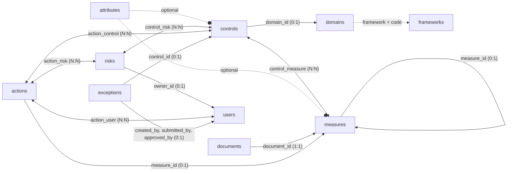
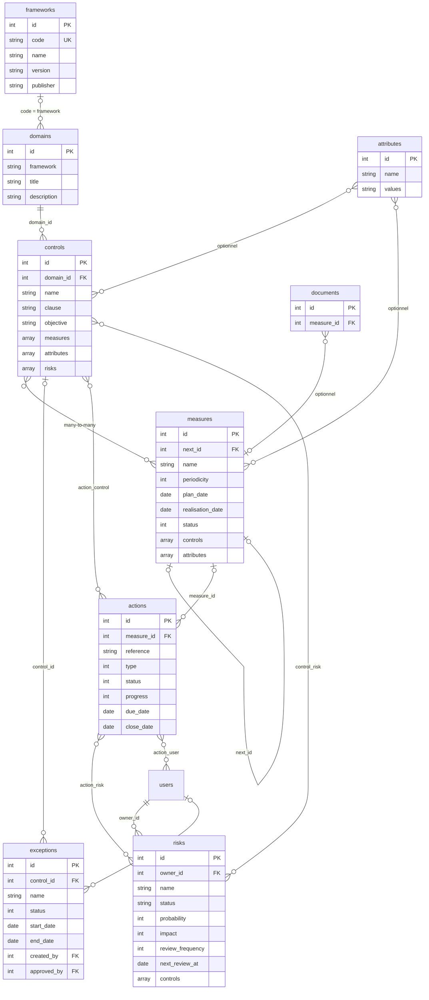

# Modèle de données

Les tables clés sont les suivantes :

- attributes
- domains
- frameworks
- controls
- measures
- documents
- risks
- actions
- exceptions

> `controls` = **mesures de sécurité** (exigences à mettre en œuvre).  
> `measures` = **contrôles** (vérifications périodiques de ces exigences).  
> `risks` = **risques de sécurité de l'information** (registre ISO 27001 §6.1.2).  
> `actions` = **plans d'action** (remédiation des contrôles en échec et des risques).  
> `exceptions` = **exceptions** (dérogations temporaires à une mesure de sécurité).

## Dépendances entre tables

Vue d'ensemble : qui utilise quoi.



Le schéma détaillé ci-dessous décrit les champs de chaque table.



Les relations sont les suivantes :

| Lien | Type | Description |
| --- | --- | --- |
| `domains` → `controls` | Clé étrangère (1:N) | Chaque mesure de sécurité référence son domaine via `domain_id` |
| `frameworks` → `domains` | Optionnel (1:N) via le code | Le champ `framework` d'un domaine contient le `code` de son référentiel ; la ligne de `frameworks` y ajoute ses métadonnées |
| `controls` ↔ `measures` | Many-to-many (bidirectionnel) | Chaque mesure de sécurité liste ses instances d'audit dans `measures[]` ; chaque instance d'audit liste ses mesures de sécurité dans `controls[]` |
| `attributes` → `controls` | Optionnel | Le champ `attributes` d'une mesure de sécurité peut contenir une liste d'IDs d'attributs |
| `attributes` → `measures` | Optionnel | Idem pour les instances d'audit |
| `measures` → `measures` | Auto-référence via `next_id` | Permet de chaîner les campagnes successives d'un même audit |
| `documents` → `measures` | Optionnel (1:N) | Les documents et preuves sont attachés aux instances d'audit via `measure_id` |
| `risks` ↔ `controls` | Many-to-many via `control_risk` | Un risque mitigé doit être lié à au moins un contrôle de sécurité ; la liste est stockée dans `controls[]` du risque |
| `users` → `risks` | Optionnel (1:N) | Chaque risque peut être attribué à un propriétaire (`owner_id`) responsable de la revue périodique |
| `measures` → `actions` | Optionnel (1:N) | Un plan d'action créé lors de la réalisation d'un contrôle le référence via `measure_id` |
| `actions` ↔ `controls` | Many-to-many via `action_control` | Mesures de sécurité (clauses) concernées par le plan d'action |
| `actions` ↔ `risks` | Many-to-many via `action_risk` | Plans d'action traitant un risque ; requis pour un risque *Non accepté* |
| `actions` ↔ `users` | Many-to-many via `action_user` | Responsables du plan d'action |
| `controls` → `exceptions` | Optionnel (1:N) | Chaque exception référence la mesure de sécurité à laquelle elle déroge via `control_id` |
| `users` → `exceptions` | Optionnel (1:N) | Auteur (`created_by`), demandeur (`submitted_by`) et valideur (`approved_by`) de l'exception |

> **Note :** il n'y a pas de table de jonction exposée pour la relation controls/measures.  
> Les IDs sont directement embarqués dans chaque objet des deux côtés.  
> La table pivot `control_risk` relie les risques aux mesures de sécurité.  
> Les tables pivot `action_control`, `action_risk` et `action_user` relient les plans d'action aux mesures de sécurité, aux risques et aux responsables.

---

## attributes

Les attributs sont des référentiels de classification multi-valeurs.  
Chaque attribut définit un ensemble de tags (préfixés `#`) qui peuvent être associés aux mesures de sécurité et aux instances d'audit.

| Champ | Type | Description |
| --- | --- | --- |
| `id` | integer | Identifiant unique (PK) |
| `name` | string | Intitulé de la taxonomie (ex : *Security measures*, *Risk_Level*) |
| `values` | string | Liste de valeurs possibles séparées par des espaces, chacune préfixée `#` (ex : `#Preventive #Detective #Corrective`) |
| `created_at` | datetime | Date de création (ISO 8601, UTC) |
| `updated_at` | datetime | Date de dernière modification |

Exemple :

```json
{
  "id": 1,
  "name": "Security measures",
  "values": "#Preventive #Detective #Corrective",
  "created_at": "2026-05-17T20:35:52.000000Z",
  "updated_at": "2026-05-17T20:35:52.000000Z"
}
```

---

## domains

Les domaines regroupent les mesures de sécurité par thématique.  
Chaque domaine appartient à un cadre réglementaire ou méthodologique (`framework`).

| Champ | Type | Description |
| --- | --- | --- |
| `id` | integer | Identifiant unique (PK) |
| `framework` | string | Référentiel d'appartenance (ex : `NIS2`, `Vulnerability Management`) |
| `title` | string | Nom du domaine (ex : *Pilotage et Gouvernance NIS2*) |
| `description` | string | Description du périmètre couvert, souvent avec référence à l'article ou à la norme |
| `created_at` | datetime | Date de création |
| `updated_at` | datetime | Date de dernière modification |

Exemple :

```json
{
  "id": 1,
  "framework": "NIS2",
  "title": "Pilotage et Gouvernance NIS2",
  "description": "Pilotage stratégique et opérationnel selon Art. 21.1 et 21.2.a",
  "created_at": "2026-05-17T20:35:52.000000Z",
  "updated_at": "2026-05-17T20:35:52.000000Z"
}
```

---

## frameworks

La table `frameworks` ajoute des métadonnées aux codes de référentiel utilisés dans `domains.framework`. Elle ne remplace
pas ce champ : un référentiel est lié à ses domaines, et à travers eux à ses mesures de sécurité, par son `code`.
Une ligne est créée automatiquement, avec le code comme nom, lorsqu'un domaine est enregistré avec un nouveau code de
référentiel. Les [correspondances](crosswalk.fr.md) utilisent ces codes pour choisir les référentiels source et cible.

| Champ | Type | Description |
| --- | --- | --- |
| `id` | integer | Identifiant unique (PK) |
| `code` | string | Code du référentiel, identique à `domains.framework` (unique, ex. : `27001:2022`) |
| `name` | string | Nom du référentiel (le code par défaut) |
| `version` | string | Version du référentiel (vide par défaut) |
| `publisher` | string | Éditeur du référentiel (vide par défaut) |
| `jurisdiction` | string \| null | Juridiction dans laquelle le référentiel s'applique |
| `source_url` | string \| null | URL de la source officielle |
| `status` | string \| null | Statut du référentiel (texte libre) |
| `publication_date` | date \| null | Date de publication |
| `effective_date` | date \| null | Date d'entrée en vigueur |
| `notes` | string \| null | Notes libres |
| `created_at` | datetime | Date de création |
| `updated_at` | datetime | Date de dernière modification |

Exemple :

```json
{
  "id": 2,
  "code": "NIS2-ReCyF-2.5-FR",
  "name": "ReCyF 2.5",
  "version": "2.5",
  "publisher": "ANSSI",
  "jurisdiction": "France",
  "source_url": "https://messervices.cyber.gouv.fr/nis2#exigences",
  "status": null,
  "publication_date": null,
  "effective_date": null,
  "notes": null
}
```

---

## controls

Les mesures de sécurité décrivent les exigences à mettre en œuvre.  
Chaque mesure de sécurité appartient à un domaine et est vérifiée par une ou plusieurs instances d'audit.

| Champ | Type | Description |
| --- | --- | --- |
| `id` | integer | Identifiant unique (PK) |
| `domain_id` | integer | Référence vers `domains.id` (FK, obligatoire) |
| `name` | string | Nom de la mesure, souvent avec le numéro d'article (ex : *Art.21.2.a - Analyse de Risques*) |
| `clause` | string | Identifiant court de la clause normative (ex : `NIS2-Art.21.2.a`) |
| `objective` | string | Objectif attendu par cette mesure de sécurité |
| `input` | string \| null | Données ou ressources nécessaires à la mise en œuvre |
| `model` | string \| null | Modèle ou méthode opérationnelle recommandée |
| `indicator` | string \| null | Indicateur de performance structuré (Target, Frequency, Owner) |
| `action_plan` | string \| null | Plan d'action ou traitement associé |
| `attributes` | array \| null | Liste d'IDs d'attributs associés ; `null` si aucun |
| `measures` | array | Liste des IDs d'instances d'audit qui vérifient cette mesure de sécurité |
| `created_at` | datetime | Date de création |
| `updated_at` | datetime | Date de dernière modification |

Exemple :

```json
{
  "id": 1,
  "domain_id": 1,
  "name": "Art.21.2.a - Analyse de Risques",
  "clause": "NIS2-Art.21.2.a",
  "objective": "Évaluation des menaces pesant sur les actifs critiques selon méthodologie EBIOS RM ou équivalent",
  "input": "Liste des actifs critiques, méthodologie EBIOS RM",
  "model": "Analyse annuelle selon ISO 27005 ou EBIOS RM",
  "indicator": "Target: Score résiduel ≤ acceptable | Frequency: Annuel | Owner: RSSI",
  "action_plan": "Plan de traitement des risques validé par Direction",
  "attributes": null,
  "measures": [1]
}
```

---

## measures

Les instances d'audit décrivent les vérifications opérationnelles périodiques.  
Une instance d'audit vérifie qu'une ou plusieurs mesures de sécurité sont bien appliquées.  
Elle porte les données de planification, de réalisation et de résultat.

| Champ | Type | Description |
| --- | --- | --- |
| `id` | integer | Identifiant unique (PK) |
| `name` | string | Intitulé de la vérification |
| `objective` | string \| null | Objectif spécifique de cette instance d'audit |
| `input` | string \| null | Données ou preuves nécessaires à la réalisation |
| `model` | string \| null | Mode opératoire de l'audit |
| `action_plan` | string \| null | Actions correctives si l'audit échoue |
| `periodicity` | integer \| null | Fréquence en mois (ex : `12` = annuel, `3` = trimestriel) |
| `plan_date` | date \| null | Date prévue de réalisation (`YYYY-MM-DD`) |
| `realisation_date` | date \| null | Date effective de réalisation |
| `observations` | string \| null | Commentaires libres sur le résultat |
| `score` | number \| null | Score numérique issu de l'évaluation ; `null` si non réalisé |
| `note` | number \| null | Note qualitative complémentaire |
| `status` | integer | État courant de l'instance d'audit (voir ci-dessous) |
| `next_id` | integer \| null | ID de l'instance suivante dans la chaîne historique (FK self) |
| `attributes` | array \| null | Liste d'IDs d'attributs associés ; `null` si aucun |
| `scope` | string \| null | Périmètre d'application (entité, site, système) |
| `controls` | array | Liste des IDs de mesures de sécurité vérifiées par cette instance d'audit |
| `created_at` | datetime | Date de création |
| `updated_at` | datetime | Date de dernière modification |

### Valeurs du champ `status`

| Valeur | Signification |
| --- | --- |
| `0` | À réaliser / Non planifié (`realisation_date` est null) |
| `1` | Proposé (l'audité a soumis un résultat, en attente de validation) |
| `2` | Réalisé / Terminé (`realisation_date` est renseignée) |

Exemple :

```json
{
  "id": 1,
  "name": "Revue et signature formelle de l'analyse de risques",
  "objective": "Validation par la direction de la stratégie de traitement des risques",
  "model": "Présentation Codir + signature formelle",
  "periodicity": 12,
  "plan_date": "2026-07-31",
  "realisation_date": "2025-03-25",
  "score": null,
  "status": 2,
  "next_id": null,
  "attributes": null,
  "scope": null,
  "controls": [1]
}
```

---

## documents

La table `documents` stocke les pièces jointes et preuves documentaires associées aux instances d'audit.  
Chaque document est lié à un enregistrement `measures` via `measure_id`.

---

## risks

Le registre des risques enregistre les risques de sécurité de l'information conformément aux exigences de la norme ISO 27001:2022 §6.1.2 et §8.2.  
Chaque risque est évalué selon une méthode de scoring configurable, optionnellement assigné à un propriétaire, et soumis à un cycle de revue périodique.  
Un risque avec le statut *Mitigé* doit être lié à au moins un contrôle de sécurité via la table pivot `control_risk`.

| Champ | Type | Description |
| --- | --- | --- |
| `id` | integer | Identifiant unique (PK) |
| `name` | string | Intitulé court et identifiable du risque (obligatoire) |
| `description` | string \| null | Description détaillée du risque |
| `owner_id` | integer \| null | Référence vers `users.id` — responsable de la revue périodique |
| `probability` | integer | Niveau de probabilité (1 à N, formules standard), ou niveau de menace avec la formule MONARC |
| `probability_comment` | string \| null | Commentaire libre sur l'évaluation de la probabilité |
| `impact` | integer | Niveau de gravité si le risque se matérialise (1 à N) |
| `impact_comment` | string \| null | Commentaire libre sur l'évaluation de l'impact |
| `exposure` | integer \| null | Accessibilité du système (formule BSI 200-3 : 0 = hors réseau, 1 = interne, 2 = Internet) |
| `vulnerability` | integer \| null | Niveau d'exploitabilité des failles connues (formule BSI 200-3), ou niveau de vulnérabilité (formule MONARC) |
| `residual_risk` | integer \| null | Risque résiduel saisi manuellement (formule MONARC uniquement) |
| `status` | enum | Décision de traitement (voir valeurs ci-dessous) |
| `status_comment` | string \| null | Commentaire libre sur la décision de traitement |
| `review_frequency` | integer | Intervalle en mois entre deux revues (défaut : 12) |
| `next_review_at` | date \| null | Date prévue de la prochaine revue |
| `controls` | array | Liste des IDs de contrôles de sécurité liés à ce risque (via `control_risk`) |
| `created_at` | datetime | Date de création |
| `updated_at` | datetime | Date de dernière modification |
| `deleted_at` | datetime \| null | Date de suppression logique |

### Valeurs du champ `status`

| Valeur | Signification |
| --- | --- |
| `not_evaluated` | Non évalué |
| `not_accepted` | Non accepté — un plan d'action lié est requis |
| `temporarily_accepted` | Accepté temporairement |
| `accepted` | Accepté |
| `mitigated` | Mitigé — au moins un contrôle de sécurité lié est requis |
| `transferred` | Transféré (assurance, tiers) |
| `avoided` | Évité |

Exemple :

```json
{
  "id": 1,
  "name": "Accès non autorisé aux données sensibles",
  "description": "Risque d'exfiltration de données via des identifiants compromis.",
  "owner_id": 3,
  "probability": 3,
  "impact": 4,
  "exposure": null,
  "vulnerability": null,
  "residual_risk": null,
  "status": "mitigated",
  "status_comment": "Politique de contrôle d'accès déployée au T1.",
  "review_frequency": 12,
  "next_review_at": "2027-06-01",
  "controls": [12, 15],
  "created_at": "2026-06-09T10:00:00.000000Z",
  "updated_at": "2026-06-09T10:00:00.000000Z",
  "deleted_at": null
}
```

---

## actions

La table `actions` contient les plans d'action mis en place pour remédier à un contrôle en échec, à une non-conformité
ou à un risque. Un plan d'action peut être créé manuellement ou lors de la réalisation d'un contrôle ; il est alors lié
à ce contrôle via `measure_id`. Les mesures de sécurité, les risques et les responsables d'un plan d'action sont
stockés dans les tables pivot `action_control`, `action_risk` et `action_user`.

| Champ | Type | Description |
| --- | --- | --- |
| `id` | integer | Identifiant unique (PK) |
| `reference` | string \| null | Référence du plan d'action (ex. : `ACT-2026-001`, 32 caractères max.) |
| `type` | integer | Type de plan d'action (voir valeurs ci-dessous) |
| `status` | integer | Statut du plan d'action (voir valeurs ci-dessous) |
| `progress` | integer \| null | Avancement en pourcentage (0 à 100) |
| `criticity` | integer | Non utilisé par l’application |
| `name` | string \| null | Nom du plan d'action |
| `scope` | string \| null | Périmètre (32 caractères max.) |
| `cause` | string \| null | Cause du plan d'action (observations du contrôle en échec) |
| `remediation` | string \| null | Remédiation à réaliser |
| `measure_id` | integer \| null | Référence vers `measures.id` — contrôle à l'origine du plan d'action |
| `creation_date` | date \| null | Date de création du plan d'action |
| `due_date` | date \| null | Date d'échéance |
| `close_date` | date \| null | Date de clôture |
| `justification` | string \| null | Justification de la clôture ou du rejet |
| `created_at` | datetime | Date de création |
| `updated_at` | datetime | Date de dernière modification |

### Valeurs du champ `type`

| Valeur | Signification |
| --- | --- |
| `1` | Non-conformité majeure |
| `2` | Non-conformité mineure |
| `3` | Observation |
| `4` | Opportunité d'amélioration |

### Valeurs du champ `status`

| Valeur | Signification |
| --- | --- |
| `0` | Ouvert |
| `1` | Clôturé |
| `2` | Rejeté |

Exemple :

```json
{
  "id": 1,
  "reference": "ACT-2026-001",
  "type": 1,
  "status": 0,
  "progress": 60,
  "criticity": 0,
  "name": "Déploiement de l'authentification multifacteur sur les comptes à privilèges",
  "scope": "Systèmes d'information",
  "cause": "Les comptes administrateur ne sont protégés que par un mot de passe, sans second facteur d'authentification.",
  "remediation": "Déployer une solution MFA (TOTP ou clé physique) sur l'ensemble des comptes à privilèges.",
  "measure_id": null,
  "creation_date": "2026-04-01",
  "due_date": "2026-09-30",
  "close_date": null,
  "justification": null
}
```

---

## exceptions

La table `exceptions` enregistre les exceptions (dérogations) accordées lorsqu'une mesure de sécurité ne peut pas être
appliquée : justification, mesures compensatoires et période de validité. Une exception suit un workflow de validation :
elle est créée en brouillon, soumise, puis approuvée ou refusée par un administrateur.

| Champ | Type | Description |
| --- | --- | --- |
| `id` | integer | Identifiant unique (PK) |
| `control_id` | integer \| null | Référence vers `controls.id` — mesure de sécurité concernée par l'exception |
| `name` | string | Nom de l'exception (obligatoire) |
| `description` | string \| null | Description de l'exception |
| `justification` | string \| null | Justification métier (raison pour laquelle la mesure de sécurité ne peut pas être appliquée) |
| `compensating_controls` | string \| null | Mesures compensatoires réduisant le risque résiduel |
| `start_date` | date \| null | Début de la période de validité |
| `end_date` | date \| null | Fin de la période de validité ; `null` si pas d'échéance |
| `status` | integer | Statut de l'exception (voir valeurs ci-dessous) |
| `created_by` | integer \| null | Référence vers `users.id` — auteur de l'exception |
| `submitted_by` | integer \| null | Référence vers `users.id` — utilisateur ayant soumis l'exception |
| `submitted_at` | datetime \| null | Date de soumission |
| `approved_by` | integer \| null | Référence vers `users.id` — administrateur ayant approuvé ou refusé l'exception |
| `approved_at` | datetime \| null | Date d'approbation ou de refus |
| `approval_comment` | string \| null | Commentaire d'approbation, ou motif du refus |
| `created_at` | datetime | Date de création |
| `updated_at` | datetime | Date de dernière modification |

### Valeurs du champ `status`

| Valeur | Signification |
| --- | --- |
| `0` | Brouillon |
| `1` | Soumise (en attente de validation) |
| `2` | Approuvée |
| `3` | Refusée |
| `4` | Expirée |

Une exception approuvée dont la date de fin est dépassée est également affichée comme expirée.

Exemple :

```json
{
  "id": 4,
  "control_id": 68,
  "name": "Maintien temporaire d'un accès VPN partagé pour un prestataire",
  "description": "Un compte VPN partagé continue d'être utilisé par le prestataire de maintenance applicative.",
  "justification": "Le projet de bascule vers des accès nominatifs a pris du retard côté prestataire.",
  "compensating_controls": "Journalisation renforcée des connexions et restriction des horaires d'accès.",
  "start_date": "2026-03-01",
  "end_date": "2026-06-01",
  "status": 3,
  "created_by": 2,
  "submitted_by": 2,
  "submitted_at": "2026-02-20T09:00:00.000000Z",
  "approved_by": 1,
  "approved_at": "2026-02-25T14:00:00.000000Z",
  "approval_comment": "Les accès nominatifs doivent être en place avant la date de fin."
}
```
