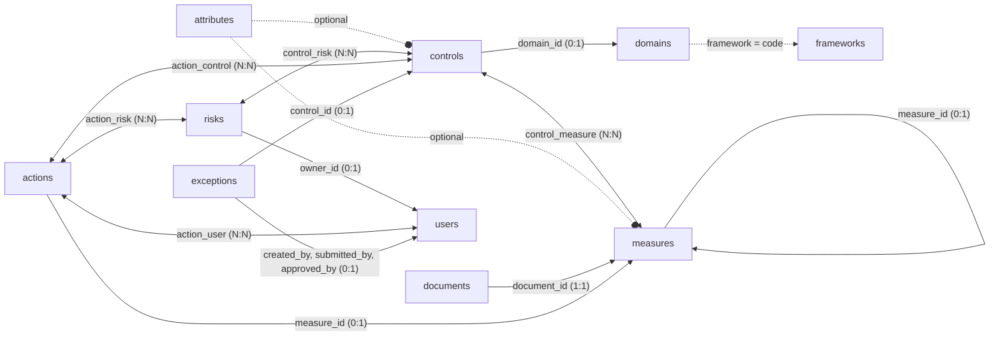
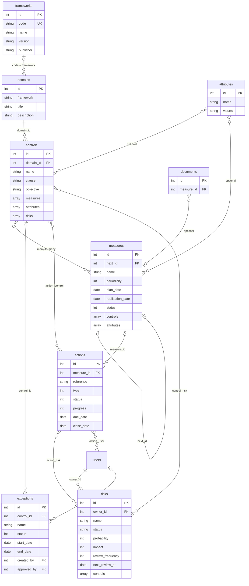

# **Data Model**

The key tables are the following:

- attributes  
- domains  
- frameworks  
- controls  
- measures  
- documents  
- risks  
- actions  
- exceptions  

> `controls` = **security measures** (requirements to implement).  
> `measures` = **audit instances** (periodic verifications of those requirements).  
> `risks` = **information security risks** (ISO 27001 §6.1.2 register).  
> `actions` = **action plans** (remediation of failed measurements and risks).  
> `exceptions` = **exceptions** (temporary waivers to a security measure).

## **Table Dependencies**

Overview: who uses what.



The detailed schema below describes the fields of each table.



The relationships are as follows:

| Link | Type | Description |
| --- | --- | --- |
| `domains` → `controls` | Foreign key (1:N) | Each security measure references its domain via `domain_id` |
| `frameworks` → `domains` | Optional (1:N) via the code | A domain's `framework` field holds the `code` of its framework; the `frameworks` row adds its metadata |
| `controls` ↔ `measures` | Many-to-many (bidirectional) | Each security measure lists its audit instances in `measures[]`; each audit instance lists its security measures in `controls[]` |
| `attributes` → `controls` | Optional | The `attributes` field of a security measure may contain a list of attribute IDs |
| `attributes` → `measures` | Optional | Same for audit instances |
| `measures` → `measures` | Self-reference via `next_id` | Allows chaining successive campaigns of the same audit |
| `documents` → `measures` | Optional (1:N) | Documents and evidence are attached to audit instances via `measure_id` |
| `risks` ↔ `controls` | Many-to-many via `control_risk` | A mitigated risk must be linked to one or more security controls; the list is stored in `controls[]` on the risk |
| `users` → `risks` | Optional (1:N) | Each risk can be assigned an owner (`owner_id`) responsible for the periodic review |
| `measures` → `actions` | Optional (1:N) | An action plan created when making a measurement references it via `measure_id` |
| `actions` ↔ `controls` | Many-to-many via `action_control` | Security measures (clauses) concerned by the action plan |
| `actions` ↔ `risks` | Many-to-many via `action_risk` | Action plans treating a risk; required for a *Not accepted* risk |
| `actions` ↔ `users` | Many-to-many via `action_user` | Owners of the action plan |
| `controls` → `exceptions` | Optional (1:N) | Each exception references the security measure it waives via `control_id` |
| `users` → `exceptions` | Optional (1:N) | Author (`created_by`), submitter (`submitted_by`) and reviewer (`approved_by`) of the exception |

> **Note:** There is no exposed join table for the controls/measures relationship.  
> IDs are directly embedded in each object on both sides.  
> The `control_risk` pivot table links risks to security controls.  
> The `action_control`, `action_risk` and `action_user` pivot tables link action plans to security measures, risks and owners.

---

## **attributes**

Attributes are multi-value classification reference sets.  
Each attribute defines a set of tags (prefixed with `#`) that can be associated with security measures and audit instances.

| Field | Type | Description |
| --- | --- | --- |
| `id` | integer | Unique identifier (PK) |
| `name` | string | Name of the taxonomy (e.g., *Security measures*, *Risk_Level*) |
| `values` | string | List of possible values separated by spaces, each prefixed with `#` (e.g., `#Preventive #Detective #Corrective`) |
| `created_at` | datetime | Creation date (ISO 8601, UTC) |
| `updated_at` | datetime | Last modification date |

Example:

```json
{
  "id": 1,
  "name": "Security measures",
  "values": "#Preventive #Detective #Corrective",
  "created_at": "2026-05-17T20:35:52.000000Z",
  "updated_at": "2026-05-17T20:35:52.000000Z"
}
```

---

## **domains**

Domains group security measures by thematic area.  
Each domain belongs to a regulatory or methodological framework (`framework`).

| Field | Type | Description |
| --- | --- | --- |
| `id` | integer | Unique identifier (PK) |
| `framework` | string | Reference framework (e.g., `NIS2`, `Vulnerability Management`) |
| `title` | string | Domain name (e.g., *NIS2 Governance and Steering*) |
| `description` | string | Description of the scope covered, often with reference to an article or standard |
| `created_at` | datetime | Creation date |
| `updated_at` | datetime | Last modification date |

Example:

```json
{
  "id": 1,
  "framework": "NIS2",
  "title": "NIS2 Governance and Steering",
  "description": "Strategic and operational steering according to Art. 21.1 and 21.2.a",
  "created_at": "2026-05-17T20:35:52.000000Z",
  "updated_at": "2026-05-17T20:35:52.000000Z"
}
```

---

## **frameworks**

The `frameworks` table adds metadata to the framework codes used in `domains.framework`. It does not replace that field:
a framework is linked to its domains, and through them to its security measures, by its `code`.
A row is created automatically, with the code as its name, when a domain is saved with a new framework code.
The [crosswalks](crosswalk.md) use these codes to select the source and target frameworks.

| Field | Type | Description |
| --- | --- | --- |
| `id` | integer | Unique identifier (PK) |
| `code` | string | Framework code, identical to `domains.framework` (unique, e.g., `27001:2022`) |
| `name` | string | Name of the framework (the code by default) |
| `version` | string | Version of the framework (empty by default) |
| `publisher` | string | Publisher of the framework (empty by default) |
| `jurisdiction` | string \| null | Jurisdiction in which the framework applies |
| `source_url` | string \| null | URL of the official source |
| `status` | string \| null | Status of the framework (free text) |
| `publication_date` | date \| null | Publication date |
| `effective_date` | date \| null | Effective date |
| `notes` | string \| null | Free notes |
| `created_at` | datetime | Creation date |
| `updated_at` | datetime | Last modification date |

Example:

```json
{
  "id": 2,
  "code": "NIS2-ReCyF-2.5-FR",
  "name": "ReCyF 2.5",
  "version": "2.5",
  "publisher": "ANSSI",
  "jurisdiction": "France",
  "source_url": "https://messervices.cyber.gouv.fr/nis2#exigences",
  "status": null,
  "publication_date": null,
  "effective_date": null,
  "notes": null
}
```

---

## **controls**

Security measures describe the requirements to be implemented.  
Each security measure belongs to a domain and is verified by one or more audit instances.

| Field | Type | Description |
| --- | --- | --- |
| `id` | integer | Unique identifier (PK) |
| `domain_id` | integer | Reference to `domains.id` (FK, required) |
| `name` | string | Name of the security measure, often with article number (e.g., *Art.21.2.a – Risk Analysis*) |
| `clause` | string | Short identifier of the normative clause (e.g., `NIS2-Art.21.2.a`) |
| `objective` | string | Expected objective of this security measure |
| `input` | string \| null | Data or resources required for implementation |
| `model` | string \| null | Recommended operational model or method |
| `indicator` | string \| null | Structured performance indicator (Target, Frequency, Owner) |
| `action_plan` | string \| null | Associated action or treatment plan |
| `attributes` | array \| null | List of associated attribute IDs; `null` if none |
| `measures` | array | List of audit instance IDs verifying this security measure |
| `created_at` | datetime | Creation date |
| `updated_at` | datetime | Last modification date |

Example:

```json
{
  "id": 1,
  "domain_id": 1,
  "name": "Art.21.2.a - Risk Analysis",
  "clause": "NIS2-Art.21.2.a",
  "objective": "Assessment of threats to critical assets using EBIOS RM or equivalent methodology",
  "input": "List of critical assets, EBIOS RM methodology",
  "model": "Annual analysis according to ISO 27005 or EBIOS RM",
  "indicator": "Target: Residual score ≤ acceptable | Frequency: Annual | Owner: CISO",
  "action_plan": "Risk treatment plan approved by Management",
  "attributes": null,
  "measures": [1]
}
```

---

## **measures**

Audit instances describe periodic operational verifications.  
An audit instance checks whether one or more security measures are properly applied.  
It contains planning, execution, and result data.

| Field | Type | Description |
| --- | --- | --- |
| `id` | integer | Unique identifier (PK) |
| `name` | string | Title of the verification |
| `objective` | string \| null | Specific objective of this audit instance |
| `input` | string \| null | Data or evidence required for execution |
| `model` | string \| null | Operating procedure |
| `action_plan` | string \| null | Corrective actions if the audit fails |
| `periodicity` | integer \| null | Frequency in months (e.g., `12` = annual, `3` = quarterly) |
| `plan_date` | date \| null | Planned execution date (`YYYY-MM-DD`) |
| `realisation_date` | date \| null | Actual execution date |
| `observations` | string \| null | Free comments on the result |
| `score` | number \| null | Numeric score from the evaluation; `null` if not yet performed |
| `note` | number \| null | Additional qualitative note |
| `status` | integer | Current status of the audit instance (see below) |
| `next_id` | integer \| null | ID of the next audit instance in the historical chain (self FK) |
| `attributes` | array \| null | List of associated attribute IDs; `null` if none |
| `scope` | string \| null | Scope of application (entity, site, system) |
| `controls` | array | List of security measure IDs verified by this audit instance |
| `created_at` | datetime | Creation date |
| `updated_at` | datetime | Last modification date |

### **Values of the `status` field**

| Value | Meaning |
| --- | --- |
| `0` | To do / Not yet performed (`realisation_date` is null) |
| `1` | Proposed (auditee submitted a result, pending validation) |
| `2` | Done / Completed (`realisation_date` is set) |

Example:

```json
{
  "id": 1,
  "name": "Formal review and signature of the risk analysis",
  "objective": "Management validation of the risk treatment strategy",
  "model": "Executive Committee presentation + formal signature",
  "periodicity": 12,
  "plan_date": "2026-07-31",
  "realisation_date": "2025-03-25",
  "score": null,
  "status": 2,
  "next_id": null,
  "attributes": null,
  "scope": null,
  "controls": [1]
}
```

---

## **documents**

The `documents` table stores attachments and documentary evidence associated with audit instances.  
Each document is linked to a `measures` record via `measure_id`.

---

## **risks**

The risk register records information security risks in accordance with ISO 27001:2022 §6.1.2 and §8.2.  
Each risk is assessed using a configurable scoring method, optionally assigned to an owner, and subject to a periodic review cycle.  
A risk with *Mitigated* status must be linked to at least one security control via the `control_risk` pivot table.

| Field | Type | Description |
| --- | --- | --- |
| `id` | integer | Unique identifier (PK) |
| `name` | string | Short, identifiable label for the risk (required) |
| `description` | string \| null | Detailed description of the risk |
| `owner_id` | integer \| null | Reference to `users.id` — person responsible for the periodic review |
| `probability` | integer | Likelihood level (1 to N, standard formulas), or threat level with the MONARC formula |
| `probability_comment` | string \| null | Free comment on the probability assessment |
| `impact` | integer | Severity level if the risk materialises (1 to N) |
| `impact_comment` | string \| null | Free comment on the impact assessment |
| `exposure` | integer \| null | System accessibility (BSI 200-3 formula only: 0 = off-network, 1 = internal, 2 = Internet) |
| `vulnerability` | integer \| null | Exploitability of known weaknesses (BSI 200-3 formula), or vulnerability level (MONARC formula) |
| `residual_risk` | integer \| null | Residual risk entered manually (MONARC formula only) |
| `status` | enum | Treatment decision (see values below) |
| `status_comment` | string \| null | Free comment on the treatment decision |
| `review_frequency` | integer | Interval in months between two reviews (default: 12) |
| `next_review_at` | date \| null | Scheduled date of the next review |
| `controls` | array | List of security control IDs linked to this risk (via `control_risk`) |
| `created_at` | datetime | Creation date |
| `updated_at` | datetime | Last modification date |
| `deleted_at` | datetime \| null | Soft-deletion date |

### **Values of the `status` field**

| Value | Meaning |
| --- | --- |
| `not_evaluated` | Not yet assessed |
| `not_accepted` | Not accepted — a linked action plan is required |
| `temporarily_accepted` | Temporarily accepted |
| `accepted` | Accepted |
| `mitigated` | Mitigated — at least one linked security control is required |
| `transferred` | Transferred (insurance, third party) |
| `avoided` | Avoided |

Example:

```json
{
  "id": 1,
  "name": "Unauthorised access to sensitive data",
  "description": "Risk of data exfiltration via compromised credentials.",
  "owner_id": 3,
  "probability": 3,
  "impact": 4,
  "exposure": null,
  "vulnerability": null,
  "residual_risk": null,
  "status": "mitigated",
  "status_comment": "Access control policy deployed in Q1.",
  "review_frequency": 12,
  "next_review_at": "2027-06-01",
  "controls": [12, 15],
  "created_at": "2026-06-09T10:00:00.000000Z",
  "updated_at": "2026-06-09T10:00:00.000000Z",
  "deleted_at": null
}
```

---

## **actions**

The `actions` table contains the action plans put in place to remedy a failed measurement, a non-conformity or a risk.
An action plan can be created manually or when making a measurement; it is then linked to this measurement via `measure_id`.
The security measures, risks and owners of an action plan are stored in the `action_control`, `action_risk` and
`action_user` pivot tables.

| Field | Type | Description |
| --- | --- | --- |
| `id` | integer | Unique identifier (PK) |
| `reference` | string \| null | Reference of the action plan (e.g., `ACT-2026-001`, 32 characters max) |
| `type` | integer | Type of action plan (see values below) |
| `status` | integer | Status of the action plan (see values below) |
| `progress` | integer \| null | Progress in percent (0 to 100) |
| `criticity` | integer | Not used by the application |
| `name` | string \| null | Name of the action plan |
| `scope` | string \| null | Scope (32 characters max) |
| `cause` | string \| null | Cause of the action plan (observations of the failed measurement) |
| `remediation` | string \| null | Remediation to carry out |
| `measure_id` | integer \| null | Reference to `measures.id` — measurement at the origin of the action plan |
| `creation_date` | date \| null | Creation date of the action plan |
| `due_date` | date \| null | Due date |
| `close_date` | date \| null | Close date |
| `justification` | string \| null | Justification of the closure or rejection |
| `created_at` | datetime | Creation date |
| `updated_at` | datetime | Last modification date |

### **Values of the `type` field**

| Value | Meaning |
| --- | --- |
| `1` | Major non-conformity |
| `2` | Minor non-conformity |
| `3` | Observation |
| `4` | Opportunity for improvement |

### **Values of the `status` field**

| Value | Meaning |
| --- | --- |
| `0` | Open |
| `1` | Closed |
| `2` | Rejected |

Example:

```json
{
  "id": 1,
  "reference": "ACT-2026-001",
  "type": 1,
  "status": 0,
  "progress": 60,
  "criticity": 0,
  "name": "Rollout of multi-factor authentication on privileged accounts",
  "scope": "Information Systems Department",
  "cause": "Administrator accounts are only protected by a password, without a second authentication factor.",
  "remediation": "Deploy an MFA solution (TOTP or hardware key) on all privileged accounts.",
  "measure_id": null,
  "creation_date": "2026-04-01",
  "due_date": "2026-09-30",
  "close_date": null,
  "justification": null
}
```

---

## **exceptions**

The `exceptions` table records the exceptions (waivers) granted when a security measure cannot be applied:
justification, compensating controls and validity period. An exception follows an approval workflow:
it is created as a draft, submitted, then approved or rejected by an administrator.

| Field | Type | Description |
| --- | --- | --- |
| `id` | integer | Unique identifier (PK) |
| `control_id` | integer \| null | Reference to `controls.id` — security measure concerned by the exception |
| `name` | string | Name of the exception (required) |
| `description` | string \| null | Description of the exception |
| `justification` | string \| null | Business justification (why the security measure cannot be applied) |
| `compensating_controls` | string \| null | Compensating controls reducing the residual risk |
| `start_date` | date \| null | Start of the validity period |
| `end_date` | date \| null | End of the validity period; `null` if no end date |
| `status` | integer | Status of the exception (see values below) |
| `created_by` | integer \| null | Reference to `users.id` — author of the exception |
| `submitted_by` | integer \| null | Reference to `users.id` — user who submitted the exception |
| `submitted_at` | datetime \| null | Submission date |
| `approved_by` | integer \| null | Reference to `users.id` — administrator who approved or rejected the exception |
| `approved_at` | datetime \| null | Approval or rejection date |
| `approval_comment` | string \| null | Comment of the approval, or reason for the rejection |
| `created_at` | datetime | Creation date |
| `updated_at` | datetime | Last modification date |

### **Values of the `status` field**

| Value | Meaning |
| --- | --- |
| `0` | Draft |
| `1` | Submitted (pending approval) |
| `2` | Approved |
| `3` | Rejected |
| `4` | Expired |

An approved exception whose end date has passed is also shown as expired.

Example:

```json
{
  "id": 4,
  "control_id": 68,
  "name": "Temporary shared VPN access for a contractor",
  "description": "A shared VPN account is still used by the application maintenance contractor.",
  "justification": "The migration to named accounts has been delayed by the contractor.",
  "compensating_controls": "Enhanced connection logging and restricted access hours.",
  "start_date": "2026-03-01",
  "end_date": "2026-06-01",
  "status": 3,
  "created_by": 2,
  "submitted_by": 2,
  "submitted_at": "2026-02-20T09:00:00.000000Z",
  "approved_by": 1,
  "approved_at": "2026-02-25T14:00:00.000000Z",
  "approval_comment": "Named accounts must be in place before the end date."
}
```
