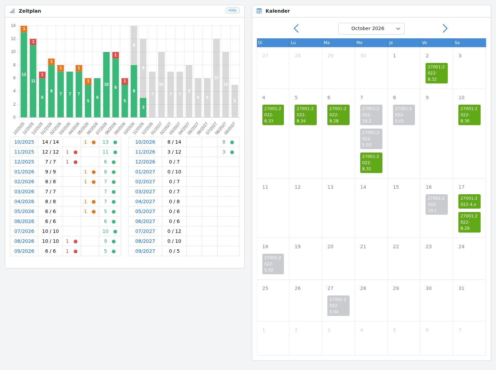

# Planung

Die Planungsansicht gibt einen Überblick über die durchgeführten und die noch durchzuführenden Kontrollen.

Der linke Teil der Ansicht enthält die vergangenen und die kommenden Kontrollen. Durch Klicken auf eine Spalte
gelangen Sie zur [Liste der Kontrollen](controls.de.md#list), die im entsprechenden Monat geplant sind.

Der rechte Teil enthält die in diesem Monat geplanten Kontrollen. Es ist möglich, den aktuellen Monat zu wechseln und
eine [Kontrolle](controls.de.md#show) im Kalender auszuwählen.
